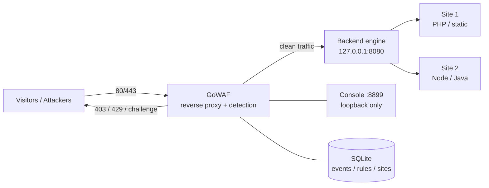
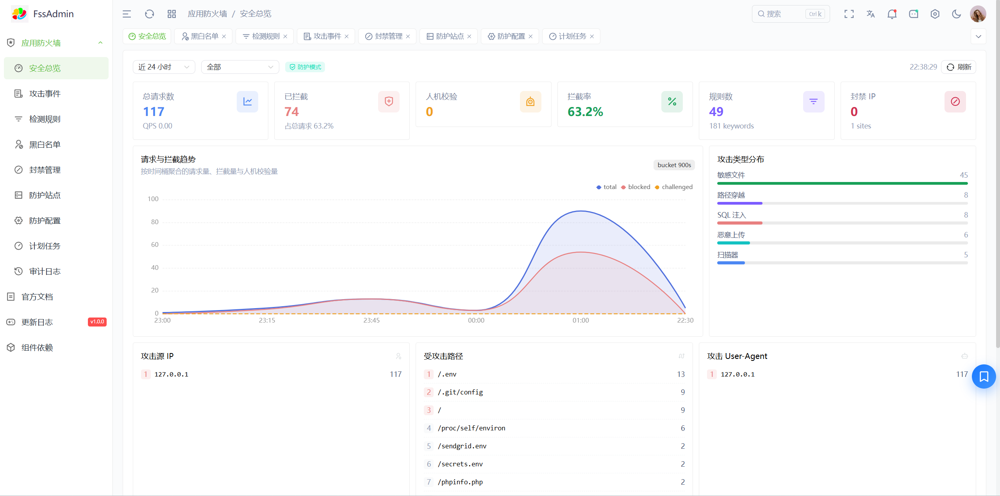
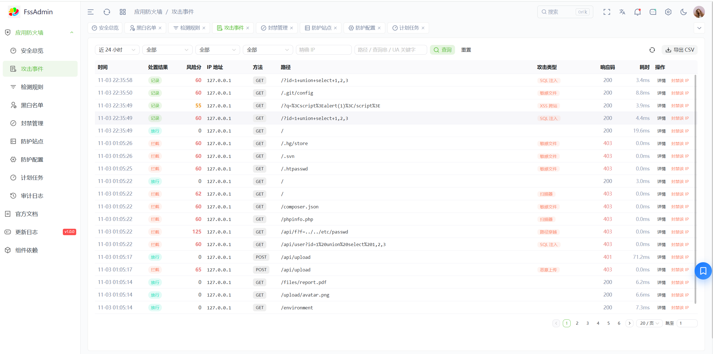
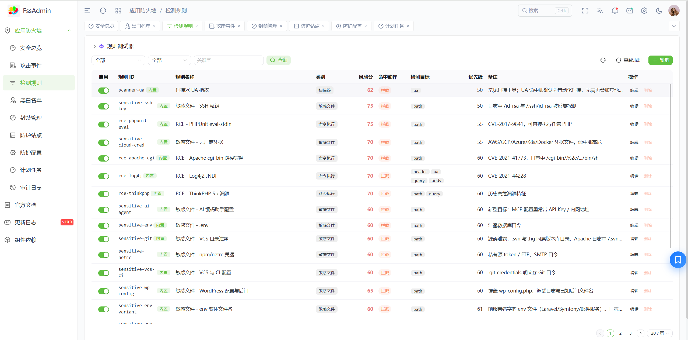
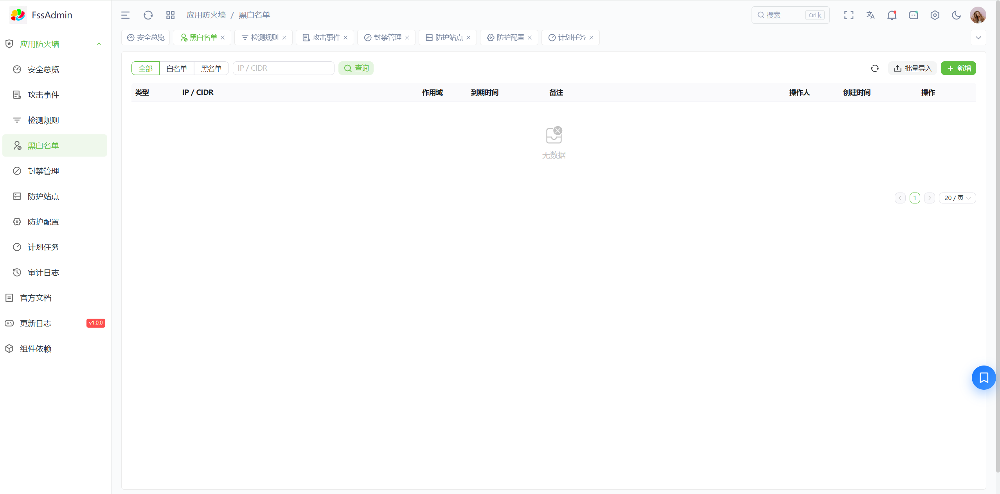
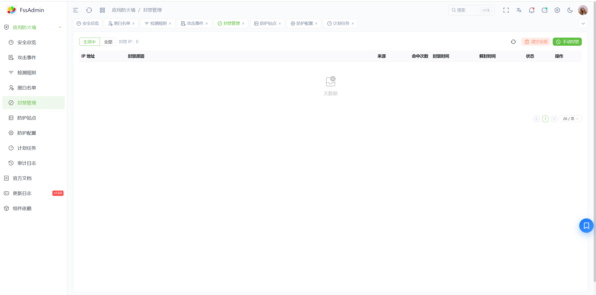
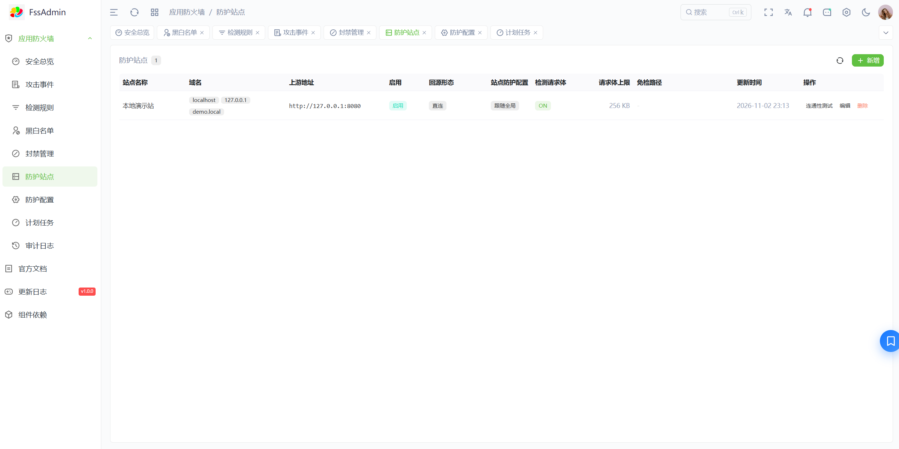
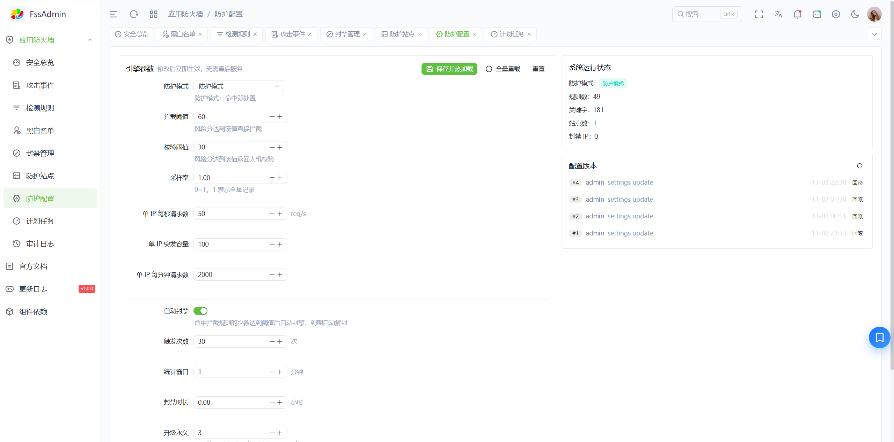
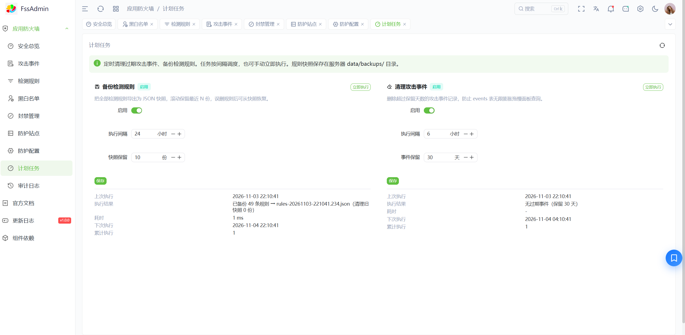

# GoWAF

**English** | [简体中文](README.zh-CN.md)

**A single-binary reverse-proxy WAF that sits in front of the web stack you already run.**

GoWAF is not a module of Apache, Nginx or IIS — it is a reverse proxy placed **in front** of
them. The installer probes your panel and engine, hands port 80/443 to GoWAF and moves the
backend to `127.0.0.1:8080`. Every public request is inspected first; clean traffic is proxied
untouched, malicious traffic is blocked before it reaches application code.



- **One binary, zero runtime deps** — console frontend and the offline IP-geo database are
  embedded with `go:embed`; SQLite is pure Go, so `CGO_ENABLED=0` cross-compiles cleanly.
- **Two detection engines** — 181 hand-written YAML rules (fast, explainable) plus embedded
  OWASP CRS v4 (broad coverage, upstream-maintained). Scores are summed into one decision.
- **Observe mode by default** — the first install only logs. Watch for 3–7 days, then flip to
  live blocking with one command.
- **Threat intel + email alerts** — subscribe to public IP feeds; hits are banned and folded
  into ban management automatically, with ban events aggregated into summary emails.
- **Always reversible** — `rollback` / `uninstall` restore the original engine config and hand
  traffic back to it.

| Panel / environment | Linux Apache | Linux Nginx / OpenResty | Windows Apache | Windows Nginx | IIS |
|---|:---:|:---:|:---:|:---:|:---:|
| **BT Panel (宝塔)** | ✓ | ✓ | ✓ | ✓ | — |
| **1Panel** | — | ✓ (OpenResty container) | — | — | — |
| **phpStudy (小皮)** | ✓ | ✓ | ✓ | ✓ | — |
| **Native (no panel)** | ✓ | ✓ | ✓ | ✓ | — |
| **IIS** | — | — | — | — | ✓ |

The data plane is engine-agnostic; all panel/engine differences live in the deploy scripts
(`deploy/install.sh`, `deploy/install.ps1`), which auto-detect what is installed.

---

## Features

| Module | Capability |
|---|---|
| **Reverse proxy** | Host passthrough, multi-site routing by domain/SNI, native WebSocket upgrade, streaming responses, transparent support for sites that proxy internally |
| **TLS termination** | 443 terminated at the WAF, multi-cert SNI + wildcard matching, reads panel certificate directories, smart `default_cert` fallback; `--http-only` leaves 443 alone |
| **Rule detection** | 181 built-in rules (SQLi / XSS / traversal / RCE / scanners / sensitive files / uploads / protocol abuse) with Aho-Corasick prefilter + RE2 match, score-based decisions, `action: ban` for instant bans — plus embedded OWASP CRS v4 (paranoia 1–4), scores merged |
| **False-positive control** | Exception rules scoped by site / rule ID / category / path prefix / parameter name, applied to both engines; rule ops include group stats, hit samples, bulk enable/disable, import & export |
| **Threat intel** | 10 preset public feeds plus custom ones (Header/Token auth, JSON lists such as AbuseIPDB, CrowdSec CTI); matching IPs are blocked and added to ban management |
| **Rate limiting & bans** | Per-IP RPS / burst / per-minute thresholds, **an independent limiter per site**, escalating auto-ban (repeat offences double the TTL, then permanent), IP whitelist, global or per-site scope |
| **Human check** | JS + SHA-256 proof-of-work challenge issued on cross-site referrers or above a soft rate threshold, solved silently in ~0.5 s, 30-minute IP-bound `waf_pass` cookie; only page navigations are challenged, API/XHR still get plain 429 |
| **Alerts** | Ban events merged into one summary email per time window with per-IP cooldown; SMTP via ssl / starttls / none (Feishu / SMS / WeChat are placeholders) |
| **IP geolocation** | Offline ip2region-derived database (216k IPv4 ranges, 1.3 MB embedded) — country/region/city in event lists, details and alert emails, no network calls |
| **Cloudflare aware** | Cloudflare's origin IP ranges loaded into `trusted_proxies`, so limiting/banning/logging use the real visitor IP (`cloudflare on` refreshes the official list) |
| **Scheduled tasks** | Periodic event cleanup by retention days, rule snapshot backups to `data/backups/`, manual trigger |
| **Console** | Vue 3 SPA with 12 modules, JWT + CSRF + login lockout + permission-bit checks on writes |
| **Self-healing ops** | Port-drift repair every 60 s after a panel saves a site, read-only `doctor` health check, logrotate |
| **Safety rails** | Upstream pointing back at the WAF itself is refused, console bound to loopback by default, startup fails on invalid config, intel matching skips loopback/private ranges |

### Console modules

`Dashboard` · `Attack events` · `Detection rules` · `Exception rules` · `Threat intel` ·
`IP allow/deny lists` · `Ban management` · `Protected sites` · `Alert notifications` ·
`Protection settings` · `Scheduled tasks` · `Audit log`

<details>
<summary><strong>Screenshots (Chinese UI; console also ships English)</strong></summary>

**Dashboard** — request/block trends, attack-type mix, top source IPs and targeted paths:



**Attack events** — risk score, matched rules, attack type and geolocation per request:



**Detection rules**, **IP lists**, **Ban management**, **Protected sites**, **Settings**, **Tasks**:








</details>

---

## Deployment

### 1. Build the binary

Requires **Go 1.27.3+** only — the console build output is committed under `internal/web/dist`,
so Node/pnpm are not needed.

```bash
make build          # current platform
make build-all      # bin/gowaf-{linux-amd64,linux-arm64,windows-amd64.exe}
make package        # dist/gowaf-deploy-<ver>-linux-amd64.tar.gz + .sha256
```

Packages can also be produced on Windows: `.\deploy\package.ps1` (Linux tar.gz) or
`.\deploy\package.ps1 -Platform windows` (Windows zip). A package contains the binary,
the installer and `rules/builtin.yaml`.

> The installer refuses to `go build` on the server — ship a compiled binary, or pass
> `--binary /path/to/gowaf`.

### 2. Linux (BT Panel, 1Panel, phpStudy, native Apache/Nginx)

```bash
tar xzf gowaf-deploy-*.tar.gz && cd gowaf-deploy-*
./install.sh doctor             # read-only: panel, engine, sites, certs, ports
./install.sh install            # deploy, observe mode by default
./install.sh protect            # after 3–7 days of clean logs: start blocking
```

Same command everywhere; the script detects panel and engine. Use `--engine nginx|apache`
only when both engines run on the same host, `--http-only` to leave 443 untouched, and
`--cloudflare` to enable Cloudflare real-IP handling at install time.

What `install` does — any failure rolls the engine config back automatically:

1. Backs up the engine config and every vhost to `<data-dir>/backup/<timestamp>/` (last 10 kept)
2. Moves the backend off 80/443 to `127.0.0.1:8080` (vhost rewrite, `listen` rewrite, or
   compose port remap for 1Panel bridge networking)
3. Injects real-IP passthrough (`mod_remoteip` / `realip`) and fixes forced-HTTPS 301 loops
4. Generates the config: site list from vhosts, plus the certificate covering the most domains
   as the default TLS cert
5. Installs `gowaf.service` (with `ExecStartPre` config validation), the port-drift timer and
   logrotate
6. Starts GoWAF on 80/443 and self-checks HTTP/HTTPS connectivity

Data, config, backups and logs live in `/www/server/gowaf`; after installation the short
command `gowaf` is symlinked into `/usr/local/bin`.

### 3. Windows (phpStudy, BT Panel, native Apache/Nginx, IIS) — admin PowerShell

```powershell
Expand-Archive gowaf-deploy-*-windows-amd64.zip
cd gowaf-deploy-*
.\install.ps1 doctor
.\install.ps1 install                 # data dir: C:\ProgramData\gowaf
.\install.ps1 install -Engine iis     # or apache / nginx; -Panel phpstudy|bt|system
.\install.ps1 rollback                # restore engine config, traffic goes direct again
```

GoWAF runs as a real Windows service (`gowaf.exe svc install|start|stop|uninstall`), no NSSM.

### Useful commands (Linux)

| Command | Purpose |
|---|---|
| `install.sh status` / `logs` | State, ports, live log |
| `install.sh observe` / `protect` | Switch detection mode |
| `install.sh cloudflare on` / `off` / `update` / `status` | Cloudflare real-IP ranges |
| `install.sh console open` / `close` / `status` | Temporarily expose the console |
| `install.sh resync` | Fix port drift caused by a panel saving a site |
| `install.sh rollback` / `uninstall` | Restore engine / restore + remove everything |

---

## Opening the admin console

The console listens on `127.0.0.1:8899` only — the intended path is an SSH tunnel, so no admin
port is ever exposed to the internet.

```bash
# On your workstation
ssh -L 8899:127.0.0.1:8899 root@<server-ip>
# Then browse http://127.0.0.1:8899  (user: admin)
```

The initial password is generated on first start and written to
`/www/server/gowaf/data/initial-password.txt` (`C:\ProgramData\gowaf\data\initial-password.txt`
on Windows). Delete `data/` and restart to regenerate it.

**Need to show it to a colleague without a tunnel?** Use the built-in temporary exposure — it
reverts itself when the timer expires:

```bash
./install.sh console open                          # allow your current SSH IP, auto-close in 2 h
./install.sh console open --ip 1.2.3.4 --hours 4
./install.sh console status                        # current state + countdown
./install.sh console close                         # revoke now
```

`console open` atomically changes three things and cross-checks them:
`admin_listen` → `0.0.0.0:8899`, `admin.allowed_ips` → the given source IP, and a host
firewall rule for 8899 (ufw / firewalld / iptables auto-detected). A systemd timer runs
`console close` on expiry. Cloud security groups still need a manual rule — and for permanent
remote access prefer Cloudflare Tunnel or a VPN rather than an open port.

Windows has no `console` subcommand: either use the SSH tunnel above, or edit
`C:\ProgramData\gowaf\config.yaml` (`server.admin_listen` plus `admin.allowed_ips`) and restart
the service.

Five failed logins lock the account for 15 minutes.

---

## Development & debugging

```bash
make run                                   # build then run with configs/config.yaml
go run ./cmd/gowaf -c configs/config.yaml  # same, without a build step
go run ./cmd/gowaf -c configs/config.yaml -t   # validate config only
go run ./cmd/gowaf -v                      # version / commit / build time
```

Local listeners from `configs/config.yaml`:

| Address | Purpose |
|---|---|
| `http://127.0.0.1:8899` | Console (admin plane) |
| `http://127.0.0.1:8089` | Data plane — simulate different sites with the `Host` header (`localhost`, `127.0.0.1`, `demo.local`) |

First start creates user `admin` with a random 16-character password in
`data/initial-password.txt`; `data/` is git-ignored, delete it and restart to reset.

### Send test traffic

```bash
# clean request -> 200
curl -s -o /dev/null -w "%{http_code}\n" -H "Host: demo.local" http://127.0.0.1:8089/

# SQL injection -> 403, event shows up in the console
curl -A "Mozilla/5.0" -s -o /dev/null -w "%{http_code}\n" -H "Host: demo.local" \
  "http://127.0.0.1:8089/?id=1+union+select+1,2,3"

# XSS -> 403
curl -A "Mozilla/5.0" -s -o /dev/null -w "%{http_code}\n" -H "Host: demo.local" \
  "http://127.0.0.1:8089/?q=%3Cscript%3Ealert(1)%3C/script%3E"

# sensitive file probe -> 403
curl -A "Mozilla/5.0" -s -o /dev/null -w "%{http_code}\n" -H "Host: demo.local" \
  http://127.0.0.1:8089/.git/config
```

`200` = allowed, `403` = blocked, `429` = rate limited. Two gotchas that look like bugs:

- **Always send a browser User-Agent.** curl's default UA matches the built-in `scanner-ua`
  rule, which is `action: ban` — you will ban `127.0.0.1` and every later request returns
  `403 X-Waf-Reason: ip_banned`. Unban it in *Ban management*.
- **Detection mode comes from the database, not the file.** `engine.mode` in `config.yaml` is
  only a seed for a fresh database; afterwards the console (or `gowaf observe|protect`) wins.
  If a payload returns 200, check the current mode first.

### Tests, lint, breakpoints

```bash
make test          # go test ./...
make test-adapter  # panel/engine adapter tests (Linux + six Windows layouts when pwsh exists)
make vet           # go vet ./...
make fmt           # gofmt
```

Good places to attach Delve (`dlv debug ./cmd/gowaf -- -c configs/config.yaml`):

| File | What happens there |
|---|---|
| `internal/edge/edge.go` | Request pipeline: whitelist → blacklist → ban → intel → challenge → rate limit → detect → proxy |
| `internal/detect/rules.go` | Rule matching and scoring |
| `internal/proxy/router.go` | Site routing by Host/SNI |

### Frontend

The console source (Vue 3 + TypeScript + Naive UI) is **not tracked** in this repository
(`Frontend/` is gitignored); a prebuilt bundle is committed under `internal/web/dist`. With a
local `Frontend/` checkout, iterate on the UI like this:

```bash
# dev server on :3006, proxy API calls to 127.0.0.1:8899 (CORS already allows this origin)
pnpm dev
# when done: pnpm build, then sync the output back and rebuild
make web && make build
```

Logs go to `logs/waf.log`; `/metrics` exposes Prometheus metrics and
`/api/stream/events` streams attack events (SSE) to the console.

---

## Project layout

```
gowaf/
├── cmd/gowaf/            # entrypoint: flags, config load, startup, Windows svc subcommand
├── cmd/geo-gen/          # builds the embedded geo database
├── internal/
│   ├── edge/             # request pipeline and challenge pages
│   ├── detect/           # Aho-Corasick + rules scoring, Coraza/CRS engine, exceptions
│   ├── guard/            # limiters, IP lists, auto-ban policy, real client IP
│   ├── intel/            # threat-feed sync and range sets
│   ├── proxy/            # reverse proxy, site routing, TLS/SNI
│   ├── runtime/          # hot-reloadable snapshots of runtime config
│   ├── admin/            # management API (auth, handlers, middleware)
│   ├── store/            # GORM + SQLite models and migrations
│   ├── notify/ geo/ tasks/ metrics/
│   └── web/              # go:embed console build output
├── rules/builtin.yaml    # 181 built-in rules (editable at runtime from the console)
├── deploy/               # install.sh, install.ps1, package.*, lab-*.sh
├── configs/config.yaml   # development configuration sample
└── Makefile              # build / build-all / test / vet / fmt / web / package
```

Console source is gitignored; the committed bundle makes `go build` self-sufficient.

---

## Known limitations

- **IIS real IP**: no `mod_remoteip` equivalent, so the backend app sees `127.0.0.1`. Limiting,
  banning and logging still use the real IP observed at the edge.
- **QUIC / HTTP3**: UDP 443 is not handled; `doctor` reports it.
- **IPv6 listeners**: not taken over (they are commented out to avoid port fights); IPv6 traffic
  still reaches the origin directly.
- **CRS costs CPU**: embedded CRS is on by default (`block`, paranoia 1). On small boxes switch
  `engine.crs.mode` to `log` or disable it.
- **Alerts are email-only**: Feishu / SMS / WeChat entries are placeholders.
- **No port-drift timer on Windows**: re-run `install.ps1 install` after a panel rewrites a port.

## License

[AGPL-3.0](./LICENSE) — full documentation (Chinese, more detail): [README.zh-CN.md](README.zh-CN.md).
