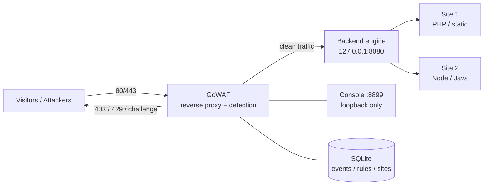
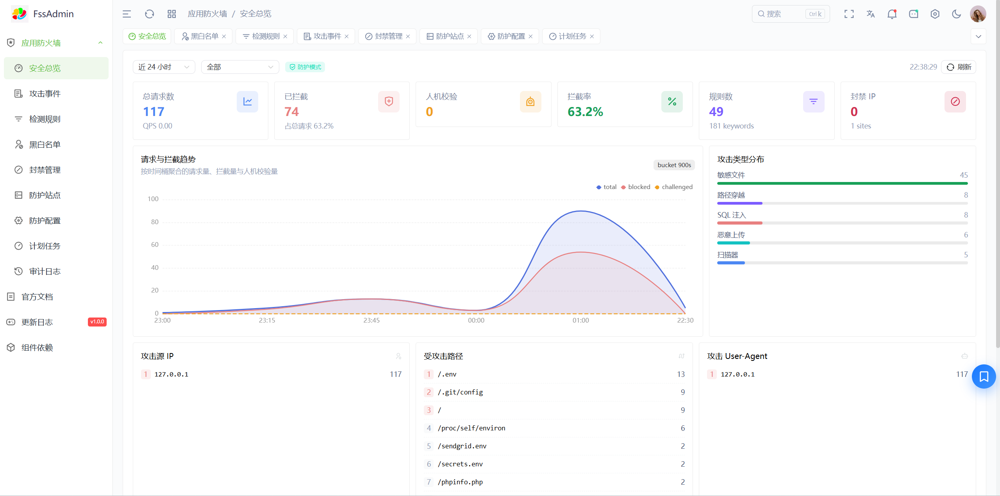
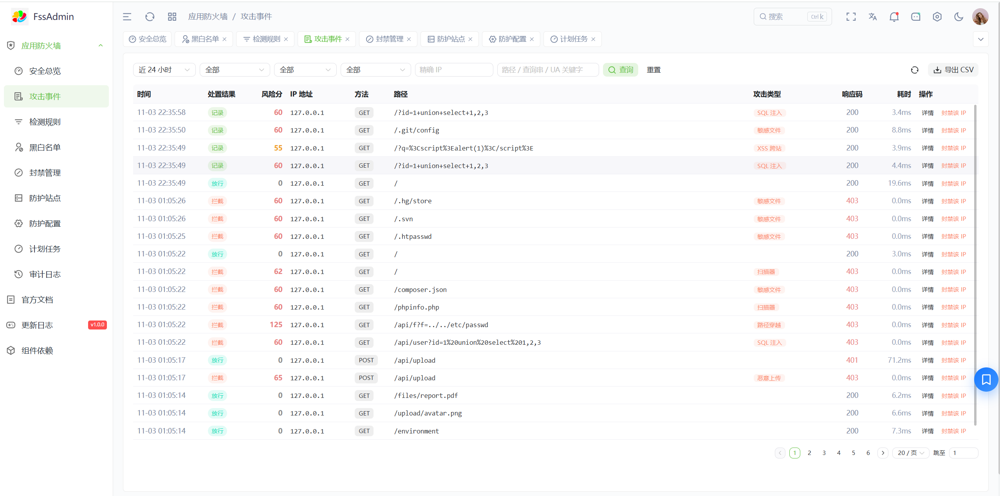
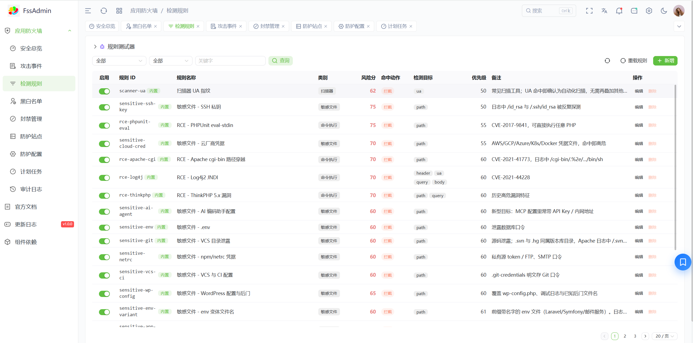
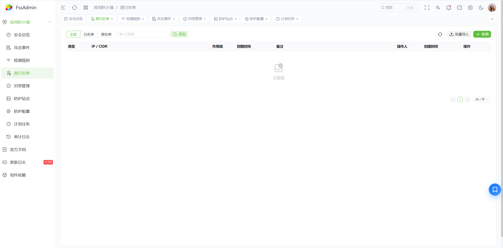
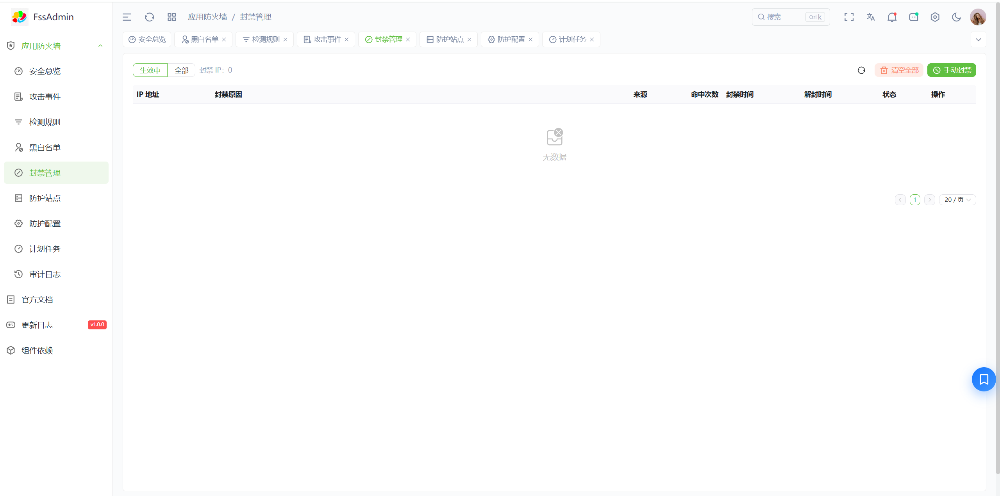
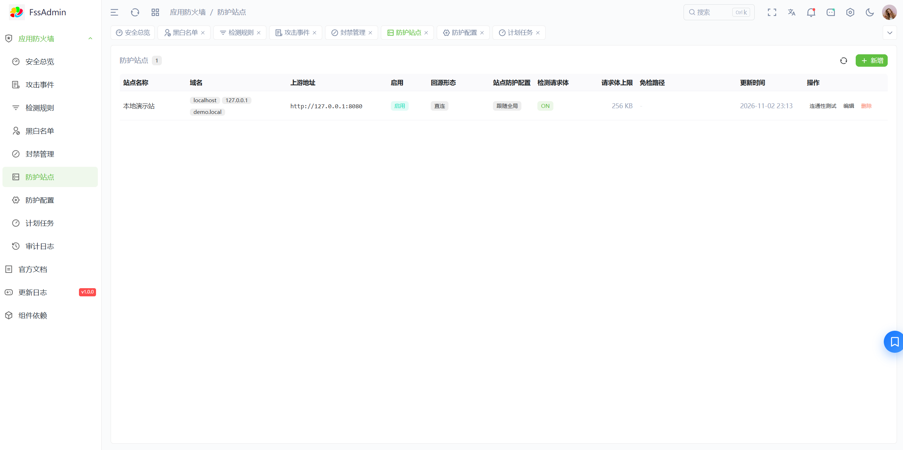
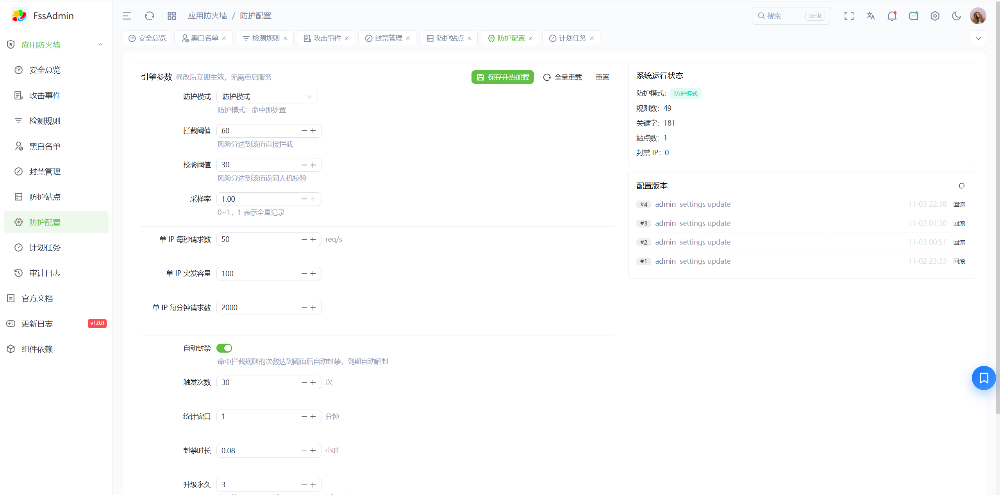
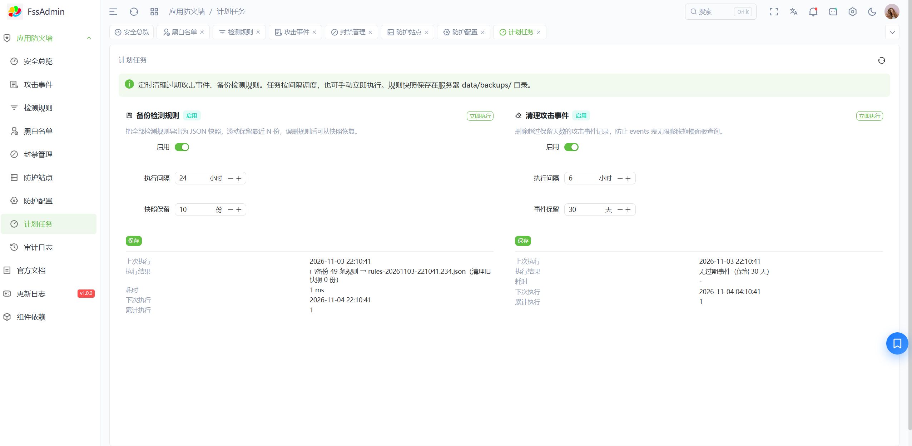

# GoWAF

**English** | [简体中文](README.zh-CN.md)

**A single-binary reverse-proxy WAF that sits in front of the web stack you already run.**

GoWAF is not a module of Apache, Nginx or IIS — it is a reverse proxy placed **in front** of
them. The installer probes your panel and engine, hands port 80/443 to GoWAF and moves the
backend to `127.0.0.1:8080`. Every public request is inspected first; clean traffic is proxied
untouched, malicious traffic is blocked before it reaches application code.



- **One binary, zero runtime deps** — console frontend and the offline IP-geo database are
  embedded with `go:embed`; SQLite is pure Go, so `CGO_ENABLED=0` cross-compiles cleanly.
- **Two detection engines** — 181 hand-written YAML rules (fast, explainable) plus embedded
  OWASP CRS v4 (broad coverage, upstream-maintained). Scores are summed into one decision.
- **Four operational engines** — access policies, bot management, page cache and multi-upstream
  sit next to detection and compose freely; all of them are off by default.
- **Observe mode by default** — the first install only logs. Watch for 3–7 days, then flip to
  live blocking with one command.
- **Threat intel + email alerts** — subscribe to public IP feeds; hits are banned and folded
  into ban management automatically, with ban events aggregated into summary emails.
- **Always reversible** — `rollback` / `uninstall` restore the original engine config and hand
  traffic back to it.

| Panel / environment | Linux Apache | Linux Nginx / OpenResty | Windows Apache | Windows Nginx | IIS |
|---|:---:|:---:|:---:|:---:|:---:|
| **BT Panel (宝塔)** | ✓ | ✓ | ✓ | ✓ | — |
| **1Panel** | — | ✓ (OpenResty container) | — | — | — |
| **phpStudy (小皮)** | ✓ | ✓ | ✓ | ✓ | — |
| **Native (no panel)** | ✓ | ✓ | ✓ | ✓ | — |
| **IIS** | — | — | — | — | ✓ |

The data plane is engine-agnostic; all panel/engine differences live in the deploy scripts
(`deploy/install.sh`, `deploy/install.ps1`), which auto-detect what is installed.

---

## Features

| Module | Capability |
|---|---|
| **Reverse proxy** | Host passthrough, multi-site routing by domain/SNI, native WebSocket upgrade, streaming responses, transparent support for sites that proxy internally |
| **TLS termination** | 443 terminated at the WAF, multi-cert SNI + wildcard matching, reads panel certificate directories, smart `default_cert` fallback; `--http-only` leaves 443 alone |
| **Certificate management & ACME** | Console "Certificates" page: inventory with expiry warnings (<30 days highlighted), upload / delete / manual reload; automated issuance via Let's Encrypt (or any ACME v2 directory) — HTTP-01 answered automatically on port 80 (intercepted before site routing), DNS-01 (mandatory for wildcards) surfaces the TXT record for you to add; issued certs land in `tls.cert_dir` and hot-reload immediately; account keys persist in `data/acme/`, staging directory supported |
| **Rule detection** | 181 built-in rules (SQLi / XSS / traversal / RCE / scanners / sensitive files / uploads / protocol abuse) with Aho-Corasick prefilter + RE2 match, score-based decisions, `action: ban` for instant bans — plus embedded OWASP CRS v4 (paranoia 1–4) — plus a **libinjection semantic channel** (`libi-*` rule IDs) doing lexical/fingerprint SQLi/XSS detection that generalizes far better than regexes against mutated payloads; all scores merged, exceptions apply to every engine |
| **Tamper protection** | Trusted-baseline integrity check for chosen exact paths: an admin-triggered refresh fetches each path from upstream (SHA-256 + bounded copy), then every 200 response is compared - `observe` logs mismatches (rule ID `tamper`), `block` **replaces** the tampered body with the trusted copy. Baselines are manual-only by design (scheduled re-fetch would cement tampered content), memory-resident, and protected paths skip the page cache automatically |
| **Pre-detection decoding** | Adds three bypass surfaces the normalizer does not cover: base64 (per query parameter, up to 3 layers), compressed request bodies (gzip/deflate/zlib by magic bytes), JSON/JS unicode escapes. Decoded variants are *additional* scan texts for the custom rules and the libinjection channel (CRS has its own transform chain); same rule counts once across variants; plausibility checks + 64 KB caps keep it DoS-safe. On by default |
| **Engine hardening** | Every engine runs behind a **timeout fuse + panic isolation**: a single engine exceeding `engine.timeout_ms` (default 2 s) trips the fuse, panics are recovered — the data plane never dies with the detector. On degradation `engine.fail_mode` decides: `open` (default) lets the request through with an `engine-degraded` attribution hit, `closed` blocks it (observe mode never blocks either way). New metric `waf_detect_errors_total` |
| **Response sensitive-data filter** | Scans response bodies for CN phone numbers / ID cards / UnionPay cards / cloud credentials (AWS, OpenAI, GitHub, Aliyun, Google, PEM private-key blocks) / JWTs: `observe` logs only, `mask` redacts in place; only 2xx text responses ≤1 MB are processed, compressed / streamed / binary payloads pass through untouched; findings never block — they are attributions only (`resp-*`, no sensitive evidence stored in events) |
| **Dynamic protection (HTML/JS encryption)** | The server derives a per-request key, encrypts every visible HTML text node and injects a decryptor script — clients that don't run JavaScript (curl, scrapers) only ever see ciphertext. Can be combined with the PoW human check (`dprotect.challenge`): visitors without a valid pass must complete the challenge before receiving the page. script/style/textarea content and attributes are untouched, parse failures fall back to the original body; protected requests skip the page cache automatically |
| **Upload & deserialization** | multipart dangerous extension, double extension, filename attacks, image magic-byte mismatch, ELF/MZ/Class executable headers; Java native streams, .NET BinaryFormatter, pickle, PHP serialization, `@type` auto-typing, unsafe YAML tags, prototype pollution — merged into the same score |
| **Access policies** | Condition tree (AND / OR / nested groups, 4 levels deep, ≤64 conditions per policy) compiled to an immutable snapshot on reload — no lock, no JSON parsing on the hot path. Fields: `client_ip` / `country` / `region` / `host` / `method` / `path` / `query` / `ua` / `referer` / `content_type` / `body` plus `header.*` / `cookie.*` / `arg.*`; operators `eq` `ne` `contains` `prefix` `suffix` `regex` `cidr` (single IP auto `/32`·`/128`) `in` numeric compare `exists`; actions `allow` `block` `challenge` `log` `ban` **`auth`** **`rate_limit`**, first match by priority wins, a compile failure keeps the previous snapshot |
| **Page password / access auth** | The `auth` action turns any condition tree into a gate: `page` mode (password form + HMAC pass cookie, default 8 h, IP-bound, per-policy cookie `waf_auth_<id>`) or `basic` (HTTP Basic for APIs). Passwords stored as bcrypt hashes only; the gate runs **before the page cache** so cached entries cannot bypass it; the unlock endpoint `/.waf-auth/<policyID>` is served ahead of every other gate |
| **Custom CC rules** | The `rate_limit` action scopes rate limiting by condition tree (path / UA / referer / geo...): fixed-window counting per "policy + IP" (10 s - 1 day window), on exceed either a 429 or the PoW human check (30-min grace). Counter buckets isolated from auto-ban tracking; runs before the cache like every other gate |
| **Bot management** | UA / Path / IP / rDNS policy types + honeypot paths (hit = ban) + behaviour scoring (window rate + suspicious UA). Search-engine bots go through forward-confirmed reverse DNS: a real Googlebot is allowed without consuming rate-limit budget, a forged UA is treated as suspicious; DNS answers are TTL-cached and never block the hot path |
| **Page cache & acceleration** | Six rule types (suffix / exact / prefix / regex / directory / anonymous whole-site); LRU + TTL with configurable total and per-object caps, over-cap responses switch to streaming passthrough immediately. Only anonymous GET/HEAD are cached; `Set-Cookie` / `private` / `no-store` are never cached, SSE / WebSocket bypass. Upstream responses are decoded (gzip / br / deflate) and re-encoded per client `Accept-Encoding`, JPEG/PNG converted to WebP — all pure Go, `CGO_ENABLED=0` builds |
| **Multi-upstream** | Weighted random by health and priority, automatic failover on connect errors (only replayable requests retry; streaming uploads never switch target), configurable health probe interval, fail-open when every target is down to avoid false 502s, connection pool reused per upstream set |
| **False-positive control** | Exception rules scoped by site / rule ID / category / path prefix / parameter name, applied to both engines; rule ops include group stats, hit samples, bulk enable/disable, import & export |
| **Threat intel** | 10 preset public feeds plus custom ones (Header/Token auth, JSON lists such as AbuseIPDB, CrowdSec CTI); matching IPs are blocked and added to ban management |
| **Rate limiting & bans** | Per-IP RPS / burst / per-minute thresholds, **an independent limiter per site**, escalating auto-ban (repeat offences double the TTL, then permanent), IP whitelist, global or per-site scope |
| **Human check** | JS + SHA-256 proof-of-work challenge issued on cross-site referrers or above a soft rate threshold, solved silently in ~0.5 s, 30-minute IP-bound `waf_pass` cookie; only page navigations are challenged, API/XHR still get plain 429 |
| **Alerts** | Ban events merged into one summary per time window with per-IP cooldown: email (SMTP via ssl / starttls / none) plus a **webhook channel** — Feishu / DingTalk (both optionally signed), WeCom, and a generic JSON POST (`{title, text, count, events}`); per-target delivery records, per-channel test buttons in the console |
| **OpenAPI & MCP** | API tokens (SHA-256 hashed at rest, plaintext shown once at creation, `read` / `read,write` scopes) authenticate via Bearer against both the existing `/api/*` routes and the `/api/v1` contract surface; read-only tokens get 403 on every write route. The `gowaf mcp` subcommand serves 11 MCP tools (overview / events / ban_ip / rule_test …) so AI clients can manage the console with just `GOWAF_URL` + `GOWAF_TOKEN` |
| **Container deployment** | Multi-stage Dockerfile (frontend artifacts are embedded — no node needed) + compose.yaml: alpine runtime, non-root user, `/healthz` healthcheck, all persistent state (SQLite / certs / JWT key / ACME account) under a single `/data` volume; `docker compose up -d --build` and done |
| **IP geolocation** | Offline ip2region-derived database (216k IPv4 ranges, 1.3 MB embedded) — country/region/city in event lists, details and alert emails, no network calls |
| **Cloudflare aware** | Cloudflare's origin IP ranges loaded into `trusted_proxies`, so limiting/banning/logging use the real visitor IP (`cloudflare on` refreshes the official list) |
| **Scheduled tasks** | Periodic event cleanup by retention days, rule snapshot backups to `data/backups/`, manual trigger |
| **Node management** | Node CRUD with token issuing; agent endpoints `GET /api/agent/config` and `POST /api/agent/heartbeat` (validated against `node.agent_token`), a node whose heartbeat exceeds `node.heartbeat_ttl` is shown offline |
| **IPv6 listeners** | Optional `server.listen_v6` / `server.tls_listen_v6` sharing the same data-plane handler; not dual-stack by default — some distros differ on `v6only`, so binding `::` unasked could break an existing v4 deployment. IPv6 ports are included in the self-loop guard |
| **Console** | Vue 3 SPA with 17 modules, JWT + CSRF + login lockout + permission-bit checks on writes (`policy:write` / `bot:write` / `cache:write` / `node:write` …) |
| **Self-healing ops** | Port-drift repair every 60 s after a panel saves a site, read-only `doctor` health check, logrotate |
| **Safety rails** | Upstream pointing back at the WAF itself is refused, console bound to loopback by default, startup fails on invalid config, intel matching skips loopback/private ranges |

### Request pipeline

Order matters, because each stage can short-circuit the rest:

```
whitelist → blacklist → ban → threat intel → bot → human check → rate limit
  → access policy (deny-only, pre-cache) → page cache → read body
  → detection (rules + CRS) → access policy (full) → proxy
```

- **Access policy runs twice.** A deny-only early pass sits *before* the cache lookup, so a
  `block` / `ban` / `challenge` policy still covers static assets that are already cached
  (cache hits return immediately and would otherwise skip the full evaluation after the body
  read). The early pass only fires when the first matching policy does not depend on `body`
  and its action is a denial — `allow` / `log` and body-dependent policies are deferred to the
  full pass, so "first match by priority wins" holds exactly.
- **Bot runs before rate limiting and the human check**, so a verified crawler is never counted
  against a client budget or challenged.
- **Cache only serves anonymous GET/HEAD**; a cached response is still recorded as an event, and
  bot attribution is carried into it instead of degrading to a bare `pass`.

### Access policies in practice

Policies are checked per site, then globally (`site` empty). A few things that are easy to get
wrong:

- `country` is an ISO 3166-1 alpha-2 string (`NL`, `US`); it comes from the embedded geo
  database, so it is a country, not an ISP or an ASN.
- `region` is always empty in the current geo database — use `country` + `path` instead.
- `cidr` accepts a bare address: `96.126.130.106` is normalised to `/32` (and `/128` for IPv6),
  including IPv4-mapped IPv6 forms.
- Hit counters are flushed to SQLite in batches; the console numbers are eventually consistent
  by a few seconds.
- `log` and `challenge` still produce events with `X-WAF-Reason: policy`, which makes them the
  right way to trial a rule before switching it to `block`.

### Page cache in practice

- Cache keys are `site|host|path?query`, so the same path on two sites never collides, and
  `?v=2` is a different object from `?v=1`.
- The cache is **in memory only**. Restarting the process clears every object — if the object
  count drops from thousands to one, check `ActiveEnterTimestamp` and the `evictions` /
  `purges` counters before suspecting the TTL.
- Upstream responses that arrive already compressed are decoded into the cache and re-encoded
  per client, which means one object serves both `br` and `gzip` clients; the object shown in
  the console is the decoded size.
- The console「Cache list」tab (`GET /api/cache/entries`) shows file name, size, path,
  remaining TTL, hit count and owning site, filterable by site and keyword.

### Console modules

`Dashboard` · `Attack events` · `Detection rules` · `Access policies` · `Bot management` ·
`Page cache` · `Exception rules` · `Threat intel` · `IP allow/deny lists` · `Ban management` ·
`Protected sites` · `Node management` · `Alert notifications` · `Protection settings` ·
`Scheduled tasks` · `Audit log`

<details>
<summary><strong>Screenshots (Chinese UI; console also ships English)</strong></summary>

**Dashboard** — request/block trends, attack-type mix, top source IPs and targeted paths:



**Attack events** — risk score, matched rules, attack type and geolocation per request:



**Detection rules**, **IP lists**, **Ban management**, **Protected sites**, **Settings**, **Tasks**:








</details>

---

## Deployment

### 1. Build the binary

Requires **Go 1.27.3+** only — the console build output is committed under `internal/web/dist`,
so Node/pnpm are not needed.

```bash
make build          # current platform
make build-all      # bin/gowaf-{linux-amd64,linux-arm64,windows-amd64.exe}
make package        # dist/gowaf-deploy-<ver>-linux-amd64.tar.gz + .sha256
```

Packages can also be produced on Windows: `.\deploy\package.ps1` (Linux tar.gz) or
`.\deploy\package.ps1 -Platform windows` (Windows zip). A package contains the binary,
the installer and `rules/builtin.yaml`.

> The installer refuses to `go build` on the server — ship a compiled binary, or pass
> `--binary /path/to/gowaf`.

### 2. Linux (BT Panel, 1Panel, phpStudy, native Apache/Nginx)

```bash
tar xzf gowaf-deploy-*.tar.gz && cd gowaf-deploy-*
./install.sh doctor             # read-only: panel, engine, sites, certs, ports
./install.sh install            # deploy, observe mode by default
./install.sh protect            # after 3–7 days of clean logs: start blocking
```

Same command everywhere; the script detects panel and engine. Use `--engine nginx|apache`
only when both engines run on the same host, `--http-only` to leave 443 untouched, and
`--cloudflare` to enable Cloudflare real-IP handling at install time.

What `install` does — any failure rolls the engine config back automatically:

1. Backs up the engine config and every vhost to `<data-dir>/backup/<timestamp>/` (last 10 kept)
2. Moves the backend off 80/443 to `127.0.0.1:8080` (vhost rewrite, `listen` rewrite, or
   compose port remap for 1Panel bridge networking)
3. Injects real-IP passthrough (`mod_remoteip` / `realip`) and fixes forced-HTTPS 301 loops
4. Generates the config: site list from vhosts, plus the certificate covering the most domains
   as the default TLS cert
5. Installs `gowaf.service` (with `ExecStartPre` config validation), the port-drift timer and
   logrotate
6. Starts GoWAF on 80/443 and self-checks HTTP/HTTPS connectivity

Data, config, backups and logs live in `/www/server/gowaf`; after installation the short
command `gowaf` is symlinked into `/usr/local/bin`.

### 3. Windows (phpStudy, BT Panel, native Apache/Nginx, IIS) — admin PowerShell

```powershell
Expand-Archive gowaf-deploy-*-windows-amd64.zip
cd gowaf-deploy-*
.\install.ps1 doctor
.\install.ps1 install                 # data dir: C:\ProgramData\gowaf
.\install.ps1 install -Engine iis     # or apache / nginx; -Panel phpstudy|bt|system
.\install.ps1 rollback                # restore engine config, traffic goes direct again
```

GoWAF runs as a real Windows service (`gowaf.exe svc install|start|stop|uninstall`), no NSSM.

### Useful commands (Linux)

| Command | Purpose |
|---|---|
| `install.sh status` / `logs` | State, ports, live log |
| `install.sh observe` / `protect` | Switch detection mode |
| `install.sh cloudflare on` / `off` / `update` / `status` | Cloudflare real-IP ranges |
| `install.sh console open` / `close` / `status` | Temporarily expose the console |
| `install.sh resync` | Fix port drift caused by a panel saving a site |
| `install.sh rollback` / `uninstall` | Restore engine / restore + remove everything |

---

## Opening the admin console

The console listens on `127.0.0.1:8899` only — the intended path is an SSH tunnel, so no admin
port is ever exposed to the internet.

```bash
# On your workstation
ssh -L 8899:127.0.0.1:8899 root@<server-ip>
# Then browse http://127.0.0.1:8899  (user: admin)
```

The initial password is generated on first start and written to
`/www/server/gowaf/data/initial-password.txt` (`C:\ProgramData\gowaf\data\initial-password.txt`
on Windows). Delete `data/` and restart to regenerate it.

**Need to show it to a colleague without a tunnel?** Use the built-in temporary exposure — it
reverts itself when the timer expires:

```bash
./install.sh console open                          # allow your current SSH IP, auto-close in 2 h
./install.sh console open --ip 1.2.3.4 --hours 4
./install.sh console status                        # current state + countdown
./install.sh console close                         # revoke now
```

`console open` atomically changes three things and cross-checks them:
`admin_listen` → `0.0.0.0:8899`, `admin.allowed_ips` → the given source IP, and a host
firewall rule for 8899 (ufw / firewalld / iptables auto-detected). A systemd timer runs
`console close` on expiry. Cloud security groups still need a manual rule — and for permanent
remote access prefer Cloudflare Tunnel or a VPN rather than an open port.

Windows has no `console` subcommand: either use the SSH tunnel above, or edit
`C:\ProgramData\gowaf\config.yaml` (`server.admin_listen` plus `admin.allowed_ips`) and restart
the service.

Five failed logins lock the account for 15 minutes.

---

## Development & debugging

```bash
make run                                   # build then run with configs/config.yaml
go run ./cmd/gowaf -c configs/config.yaml  # same, without a build step
go run ./cmd/gowaf -c configs/config.yaml -t   # validate config only
go run ./cmd/gowaf -v                      # version / commit / build time
```

Local listeners from `configs/config.yaml`:

| Address | Purpose |
|---|---|
| `http://127.0.0.1:8899` | Console (admin plane) |
| `http://127.0.0.1:8089` | Data plane — simulate different sites with the `Host` header (`localhost`, `127.0.0.1`, `demo.local`) |

First start creates user `admin` with a random 16-character password in
`data/initial-password.txt`; `data/` is git-ignored, delete it and restart to reset.

### Send test traffic

```bash
# clean request -> 200
curl -s -o /dev/null -w "%{http_code}\n" -H "Host: demo.local" http://127.0.0.1:8089/

# SQL injection -> 403, event shows up in the console
curl -A "Mozilla/5.0" -s -o /dev/null -w "%{http_code}\n" -H "Host: demo.local" \
  "http://127.0.0.1:8089/?id=1+union+select+1,2,3"

# XSS -> 403
curl -A "Mozilla/5.0" -s -o /dev/null -w "%{http_code}\n" -H "Host: demo.local" \
  "http://127.0.0.1:8089/?q=%3Cscript%3Ealert(1)%3C/script%3E"

# sensitive file probe -> 403
curl -A "Mozilla/5.0" -s -o /dev/null -w "%{http_code}\n" -H "Host: demo.local" \
  http://127.0.0.1:8089/.git/config
```

`200` = allowed, `403` = blocked, `429` = rate limited. Two gotchas that look like bugs:

- **Always send a browser User-Agent.** curl's default UA matches the built-in `scanner-ua`
  rule, which is `action: ban` — you will ban `127.0.0.1` and every later request returns
  `403 X-Waf-Reason: ip_banned`. Unban it in *Ban management*.
- **Detection mode comes from the database, not the file.** `engine.mode` in `config.yaml` is
  only a seed for a fresh database; afterwards the console (or `gowaf observe|protect`) wins.
  If a payload returns 200, check the current mode first.

### Tests, lint, breakpoints

```bash
make test          # go test ./...
make test-adapter  # panel/engine adapter tests (Linux + six Windows layouts when pwsh exists)
make vet           # go vet ./...
make fmt           # gofmt
```

Good places to attach Delve (`dlv debug ./cmd/gowaf -- -c configs/config.yaml`):

| File | What happens there |
|---|---|
| `internal/edge/edge.go` | Request pipeline: whitelist → blacklist → ban → intel → bot → challenge → rate limit → early policy → cache → detect → policy → proxy |
| `internal/detect/rules.go` | Rule matching and scoring |
| `internal/policy/policy.go` | Condition tree compilation and `EvaluateDenyEarly` (the pre-cache deny pass) |
| `internal/bot/bot.go` | Bot verdict: honeypot → explicit policy → rDNS verification → behaviour score |
| `internal/edge/accelerate.go` | Cache write path: buffering, flush grace, decoding, re-compression |
| `internal/proxy/router.go` | Site routing by Host/SNI |

### Frontend

The console source (Vue 3 + TypeScript + Naive UI) is **not tracked** in this repository
(`Frontend/` is gitignored); a prebuilt bundle is committed under `internal/web/dist`. With a
local `Frontend/` checkout, iterate on the UI like this:

```bash
# dev server on :3006, proxy API calls to 127.0.0.1:8899 (CORS already allows this origin)
pnpm dev
# when done: pnpm build, then sync the output back and rebuild
make web && make build
```

Logs go to `logs/waf.log`; `/metrics` exposes Prometheus metrics and
`/api/stream/events` streams attack events (SSE) to the console.

---

## Project layout

```
gowaf/
├── cmd/gowaf/            # entrypoint: flags, config load, startup, Windows svc subcommand
├── cmd/geo-gen/          # builds the embedded geo database
├── internal/
│   ├── edge/             # request pipeline and challenge pages
│   ├── detect/           # Aho-Corasick + rules scoring, Coraza/CRS engine, exceptions, upload/deserialization
│   ├── policy/           # access policies: condition-tree compiler, snapshot set, early deny verdict
│   ├── bot/              # bot policies, honeypots, behaviour scoring, forward-confirmed rDNS
│   ├── cache/            # page cache: LRU + TTL store, rules, gzip/br/deflate + WebP, entry listing
│   ├── guard/            # limiters, IP lists, auto-ban policy, real client IP
│   ├── intel/            # threat-feed sync and range sets
│   ├── proxy/            # reverse proxy, site routing, TLS/SNI
│   ├── runtime/          # hot-reloadable snapshots of runtime config
│   ├── admin/            # management API (auth, handlers, middleware)
│   ├── store/            # GORM + SQLite models and migrations
│   ├── notify/ geo/ tasks/ metrics/
│   └── web/              # go:embed console build output
├── rules/builtin.yaml    # 181 built-in rules (editable at runtime from the console)
├── deploy/               # install.sh, install.ps1, package.*, lab-*.sh
├── configs/config.yaml   # development configuration sample
└── Makefile              # build / build-all / test / vet / fmt / web / package
```

Console source is gitignored; the committed bundle makes `go build` self-sufficient.

---

## Known limitations

- **IIS real IP**: no `mod_remoteip` equivalent, so the backend app sees `127.0.0.1`. Limiting,
  banning and logging still use the real IP observed at the edge.
- **QUIC / HTTP3**: UDP 443 is not handled; `doctor` reports it.
- **IPv6 is opt-in**: v1.3.0 added `server.listen_v6` / `server.tls_listen_v6`, but the
  installer still comments v6 listeners out on the engine and never binds `::` by itself —
  some distros differ on `v6only`, so silently going dual-stack could break a working box.
  Until you configure the v6 listeners, IPv6 traffic reaches the origin directly.
- **Page cache is per-process and in memory**: no shared store between nodes and no warm-up
  after a restart. Size it with `cache.settings`, or leave big media uncached.
- **Bot rDNS verification needs working reverse DNS**: behind a resolver that answers
  `NXDOMAIN` for everything, every crawler looks fake — the console shows the last error and
  the engine treats unverified bots as suspicious only when `bot.verify_rdns` is on.
- **CRS costs CPU**: embedded CRS is on by default (`block`, paranoia 1). On small boxes switch
  `engine.crs.mode` to `log` or disable it.
- **Alerts are email-only**: Feishu / SMS / WeChat entries are placeholders.
- **No port-drift timer on Windows**: re-run `install.ps1 install` after a panel rewrites a port.

## Documentation

| Document | Contents |
|---|---|
| [README.zh-CN.md](README.zh-CN.md) | Full Chinese manual (principle, panel adaptation, troubleshooting) |
| [docs/精准访问控制-设置.md](docs/精准访问控制-设置.md) | Access policies: field/operator reference, worked examples (block a country, block an IP, path + header combinations), trial-then-enforce workflow |
| [docs/Bot管理-设置.md](docs/Bot管理-设置.md) | Bot policies: UA / path / IP / rDNS regex patterns, honeypots, scoring, verification checklist |
| [docs/缓存与CDN加速-设置.md](docs/缓存与CDN加速-设置.md) | Page cache: rule recipes for css/js/images, compression, cache list, why the object count drops |
| [CHANGELOG.md](CHANGELOG.md) | Release notes |

## License

[AGPL-3.0](./LICENSE) — full documentation (Chinese, more detail): [README.zh-CN.md](README.zh-CN.md).
