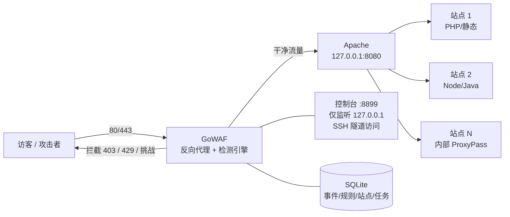
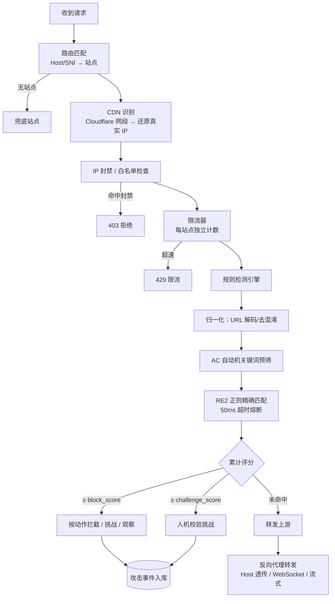
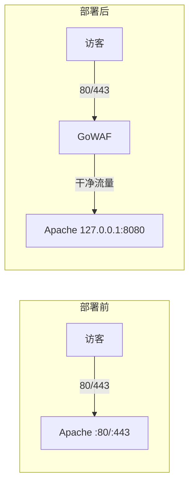

# GoWAF

**一个面向「宝塔 / 1Panel / 原生 Apache 或 Nginx」的单二进制 Go 反向代理 WAF。**

GoWAF 不是 Apache/Nginx 的一个模块，而是站在 Web 服务器**前面**的一层反向代理：
安装脚本把 80/443 交给 GoWAF，Apache 退到 `127.0.0.1:8080`，所有公网流量先过
GoWAF 检测，干净的请求原样转发给后端，恶意请求在到达业务代码之前就被拦截。

- **单二进制部署**：控制台前端通过 `go:embed` 打进二进制，一个文件 + 一个 install.sh 即可上线
- **默认观察模式**：首次安装只记录不拦截，观察 3~7 天确认无误杀再切实时拦截
- **随时全身而退**：`rollback` / `uninstall` 自动还原 Apache 配置并重新接管流量

> 适用环境：Ubuntu/Debian + 宝塔 / 1Panel / 小皮 / 原生 systemd，引擎为 Apache 或 Nginx。
> 部署脚本自动探测面板与引擎；同机双引擎时加 `--engine nginx` 或 `--engine apache`。

---

## Demo 示意图： https://github.com/xuey490/GoWaf/tree/main/demo


## 目录

- [工作原理](#工作原理)
- [功能一览](#功能一览)
- [界面预览](#界面预览)
- [技术栈](#技术栈)
- [快速开始](#快速开始)
- [打包与部署](#打包与部署)
- [安装场景指南](#安装场景指南)
- [反复安装 / 回滚 / 彻底卸载](#反复安装--回滚--彻底卸载)
- [控制台临时对外开放](#控制台临时对外开放)
- [命令速查](#命令速查)
- [本地开发与调试](#本地开发与调试)
- [项目结构](#项目结构)
- [关键技术细节](#关键技术细节)
- [系统亮点](#系统亮点)

---

## 工作原理

### 整体架构



### 请求处理流水线



### 流量接管方式（部署前后对比）



---

## 功能一览

| 模块 | 能力 |
|---|---|
| **反向代理** | Host 透传、多站点按域名/SNI 分流、WebSocket 原生升级、流式响应（FlushInterval）、内部 ProxyPass 站点透明兼容 |
| **TLS 终止** | 443 在 WAF 终止，SNI 多证书 + 通配符匹配，自动读取宝塔证书目录，`default_cert` 智能兜底；`--http-only` 可只接管 80 |
| **规则检测** | 49 条内置规则（参考 OWASP CRS 思路）：SQLi / XSS / 路径穿越 / RCE / 扫描器 / 敏感文件 / 文件上传 / 协议异常；评分制（block_score / challenge_score 热更新） |
| **限流与封禁** | 单 IP RPS / 突发 / 每分钟阈值；**每站点独立限流实例**（互不占用全局指标）；自动封禁带连击机制（反复触发 → 加倍 → 永久封禁）；IP 白名单 |
| **站点级防护配置** | 全局配置 + 各站点覆盖：站点开启后以站点为准，限流计数按「站点 + IP」隔离 |
| **Cloudflare 适配** | 回源网段写入 trusted_proxies，按真实访客 IP 限流/封禁/记录（`cloudflare on` 一键开启，支持联网刷新官方网段）；CDN 标记支持全局或按站点 |
| **计划任务中心** | 定期清理攻击事件（按保留天数）、定期备份规则快照到 `data/backups/`，支持手动触发 |
| **控制台** | Vue 3 单页管理端：仪表盘 / 攻击事件 / 规则管理 / 站点管理（含防护弹窗、CDN 标记）/ 封禁与 IP 名单 / 计划任务 / 设置；JWT + CSRF + 登录锁定 |
| **自愈与运维** | 端口漂移自愈（宝塔改回端口每 60 秒自动纠正）、`doctor` 只读体检（部署形态 / 证书对照表 / 站点清单 / 端口占用）、日志 logrotate |
| **安全防线** | 无限代理自环防护（上游指向自身 80/443/8899 拒绝加载）、控制台默认仅回环、配置校验失败拒绝启动 |

---

## 界面预览

**安全总览** —— 请求/拦截趋势、攻击类型分布、攻击源 IP 与受攻击路径一目了然：


**攻击事件** —— 每条请求的风险分、命中规则、攻击类型与响应码，支持导出 CSV：


<details>
<summary><strong>更多控制台截图（点击展开）</strong></summary>

**检测规则** —— 49 条内置规则在线启停/调分/编辑，带规则调试器：


**黑白名单** —— IP / CIDR 白名单与黑名单，支持批量导入：


**封禁管理** —— 自动封禁与手动封禁统一管理，一键全量解封：


**防护站点** —— 站点清单、上游地址、CDN 形态与站点级防护配置：


**防护配置** —— 全局阈值 / 限流 / 自动封禁参数，改动即生效并留配置版本可回滚：


**计划任务** —— 定期备份检测规则、定期清理攻击事件，可手动立即执行：


</details>

---

## 技术栈

**后端（Go）**

| 组件 | 选型 | 说明 |
|---|---|---|
| HTTP 服务 | `net/http` + `httputil.ReverseProxy` | 数据面，Rewrite 保留 RawPath，Host 透传 |
| 管理面 | Gin + GORM | `/api` 路由、SQLite 存储 |
| 存储 | SQLite（glebarez 纯 Go 驱动，CGO_ENABLED=0） | 零依赖，静态编译，可交叉编译 |
| 检测 | AC 自动机（自实现）+ RE2 正则 | 关键词预筛 → 正则精匹配，正则 50ms 超时熔断 |
| 认证 | golang-jwt v5 + CSRF + IP 白名单 | 控制台安全 |
| 热更新 | `atomic.Value` / `atomic.Int64` | 阈值、规则、封禁策略改完即生效，不重启 |
| 迁移 | 顺序 SQL migrations（`internal/store/migrations`） | 升级自动补表/补列 |
| 嵌入 | `go:embed` | 前端产物打进二进制，交付一个文件 |

**前端（控制台）**

Vue 3.5 + TypeScript + Vite + Naive UI + Pinia + Vue Router + vue-i18n（中英双语）+ ECharts

---

## 快速开始

前提：`go 1.27+` 即可（前端构建产物已直接提交在 `internal/web/dist`，不需要 node/pnpm）。

```bash
# 构建 Linux 二进制（前端产物 go:embed 进二进制）
make build-all        # 产出 bin/gowaf-linux-amd64 / arm64 / windows-amd64

# 也可以只构建本机平台
make build
```

> 只有要修改控制台界面时才需要前端源码 `Frontend/`（独立维护，不在本仓库内）。
> 改完执行 `make web` 同步回 `internal/web/dist` 再提交。

服务器上（Ubuntu + 宝塔 Apache 或 Nginx）：

```bash
tar xzf gowaf-deploy-*.tar.gz && cd gowaf-deploy-*
./install.sh install            # 一键部署，默认 observe 观察模式
ssh -L 8899:127.0.0.1:8899 root@<服务器IP>   # 隧道访问控制台
# 浏览器打开 http://127.0.0.1:8899 ，账号 admin（初始密码见 /www/server/gowaf/data/initial-password.txt）

# 观察 3~7 天确认无误杀后，切实时拦截：
./install.sh protect
```

**安装过程做了什么（每一步失败都会自动回滚 Apache，站点不会长时间中断）：**

1. 备份 `httpd.conf` 与全部 vhost 到 `/www/server/gowaf/backup/<时间戳>/`（保留最近 10 份）
2. 注释 Apache 的 `Listen 80/443`，注入 `Listen 127.0.0.1:8080` + `mod_remoteip`（真实 IP）+ `SetEnvIf`（HTTPS 标记防 301 死循环）
3. 把各站点 vhost 的 `<VirtualHost *:80>` 改写为 `<VirtualHost 127.0.0.1:8080>`
4. 生成配置（自动从宝塔 vhost 提取站点清单 + 自动挑选覆盖域名最多的 TLS 默认证书）
5. 安装 `gowaf.service`（`ExecStartPre` 先校验配置）+ 端口漂移自愈定时器 + logrotate
6. 启动 gowaf 绑定 80/443，做 HTTP/HTTPS 连通性自检

---

## 打包与部署

### 方式一：PowerShell 一键打包（Windows 开发机）

```powershell
.\deploy\package.ps1                          # linux/amd64 tar.gz（用仓库自带前端产物）
.\deploy\package.ps1 -Arch arm64              # 交叉编译 arm64
.\deploy\package.ps1 -Platform windows        # windows/amd64 zip（服务模式 + IIS/小皮适配）
.\deploy\package.ps1 -WithWebBuild            # 本机有 Frontend 源码时：先 pnpm build 再打包
```

产出（位于 `dist/`）：

```
gowaf-deploy-<版本>-linux-amd64.tar.gz / .sha256
gowaf-deploy-<版本>-windows-amd64.zip / .zip.sha256
```

包内容：二进制 + 部署脚本 + `rules/builtin.yaml`。

## 多面板 / 多引擎部署

GoWAF 是**引擎无关**的：数据面对后端是 Apache 还是 Nginx 完全无感，部署脚本自动探测面板与引擎并做端口接管（`deploy/install.sh` 适配器架构，详见 [docs/panel-adaptation-assessment.md](docs/panel-adaptation-assessment.md)）。

| 环境 | 接管方式 | 说明 |
|---|---|---|
| 宝塔/小皮 Linux + Apache | vhost 端口改写 + mod_remoteip | 原 Apache 链路，实战最多 |
| 宝塔/小皮 Linux + Nginx | server 块级 listen 改写 + realip | 自动处理 default_server 冲突、强制 HTTPS 301 死循环 |
| 1Panel + OpenResty (Docker) | compose 端口重映射 `80:80 → 8080:80` | 容器内配置零侵入，升级不回退 |
| 原生 systemd Nginx/Apache | 常规接管 | 无面板环境 |
| 小皮 Windows / IIS | `install.ps1`（见下） | Windows 服务模式 |

```bash
# Linux（服务器上）
bash install.sh install                       # 自动探测面板与引擎
bash install.sh install --engine nginx        # 同机双引擎时显式指定
bash install.sh doctor                        # 只读体检：面板/引擎/站点/证书/端口
```

Windows（管理员 PowerShell）：

```powershell
.\install.ps1 doctor       # 探测 IIS / 小皮 Apache / 小皮 Nginx、站点清单、端口
.\install.ps1 install      # 备份 → 引擎让出 80/443 → gowaf svc 开机自启 → 防火墙
.\install.ps1 rollback     # 一键还原，流量回到引擎直连
```

Windows 说明：服务模式用 `gowaf svc install|start|stop|uninstall` 实现（单二进制，无 NSSM 依赖）；IIS 走 appcmd 改 `applicationHost.config` 绑定（https 绑定转 http，TLS 由 WAF 终止）；已知降级——IIS 后端应用看到的客户端 IP 是 127.0.0.1（IIS 无 realip 模块），WAF 侧限流/封禁不受影响。

### 方式二：Linux 一键打包（Makefile / package.sh）

```bash
make package                 # linux/amd64 tar.gz + sha256，产出在 dist/
bash deploy/package.sh arm64 # 交叉编译 arm64
```

### 方式三：Makefile 手动打包

```bash
make build-all
mkdir gowaf-deploy && cp bin/gowaf-linux-amd64 deploy/install.sh rules/builtin.yaml gowaf-deploy/
tar czf gowaf-deploy.tar.gz gowaf-deploy/
sha256sum gowaf-deploy.tar.gz > gowaf-deploy.tar.gz.sha256
```### 上传与安装

```bash
scp gowaf-deploy-*.tar.gz root@服务器IP:/tmp/
ssh root@服务器IP
cd /tmp && tar xzf gowaf-deploy-*.tar.gz && cd gowaf-deploy-*
sha256sum -c ../gowaf-deploy-*.tar.gz.sha256   # 可选：校验完整性（按实际文件名调整）
./install.sh install
```

> 注意：脚本**不接受**在服务器上 `go build`（生产环境缺 git/前端产物必然失败），
> 必须带上编译好的二进制，或用 `--binary /path/to/gowaf` 显式指定。
> 升级重装时**不会覆盖**服务器上已有的规则文件（你在生产上调优的规则比仓库新），要强制覆盖加 `--rules`。

---

## 安装场景指南

### 场景 A：普通 HTTP 站点（未上 CDN）

最简单的情况，直接装：

```bash
./install.sh install
```

- 脚本自动扫描 Apache vhost 生成站点清单，上游统一 `http://127.0.0.1:8080`
- 证书目录为空 → 只接管 80，443 原样留给 Apache（HTTPS 流量不经过 WAF）
- 证书目录有证书（宝塔 SSL）→ 自动接管 80 + 443，TLS 由 WAF 终止
- 想强制最保守上线（即使有证书也不碰 443）：

```bash
./install.sh install --http-only
```

> WAF 页面里的「上游地址」统一填 `http://127.0.0.1:8080` 即可——这是安装时
> Apache 让出 80 后退守的内部端口。站点内部如果还有多条 `ProxyPass`（前后端分离、
> 多个后端端口），**不需要**在 WAF 里逐条配置：WAF 只管把域名流量整包转给 Apache，
> Apache vhost 内部的 ProxyPass 分发逻辑原样保留。

### 场景 B：Cloudflare 橙云站点（或混合部署）

橙云站点的回源 IP 是 Cloudflare 节点而非真实访客。不处理的话，限流/封禁会按
CF 节点 IP 计算——**一封一大片**。

**全部站点都在 CF 后面**（安装时直接声明）：

```bash
./install.sh install --cloudflare
```

**混合部署（一部分橙云 + 一部分直连）**，装完再按需开关：

```bash
./install.sh install
./install.sh cloudflare on       # 全局启用：CF 回源网段写入 trusted_proxies
./install.sh cloudflare status   # 查看当前状态与网段数
./install.sh cloudflare update   # 联网刷新 Cloudflare 官方最新网段
./install.sh cloudflare off      # 全部直连时关闭
```

更精细的控制：在控制台「站点管理」里对**单个站点**标记「Cloudflare 加速」，
只对该站点做真实 IP 还原，其他站点保持直连语义。混合场景下全局开关 + 站点级
标记可以自由组合。

**CF 站点还有两条配套要求：**

- Cloudflare SSL/TLS 模式必须是 **Full 或 Full (strict)**；Flexible 会导致 301 死循环
- 每个走 CF 的域名都要有证书覆盖（回源 SNI 对不上证书时 Full (strict) 会报 526）。
  装完跑一次 `./install.sh doctor`，它会输出「域名 → 证书目录」对照表并列出无证书覆盖的域名

### 场景 C：拿不准服务器现状？

先体检，不动任何东西：

```bash
./install.sh doctor
```

输出：当前部署形态（是否已接管 443）、每张证书的 SAN 与覆盖的域名、全部 vhost
的 ServerName/Alias、站点 → 证书对照表、80/443/8080/8899 端口占用者、Apache
配置语法与连通性自检。

---

## 反复安装 / 回滚 / 彻底卸载

### 可以反复 install 吗？

**可以，install 是幂等的，专门为重装/升级设计：**

- 检测到已安装 → 提示「重新生成配置并重启服务」，确认后继续（`--force` 跳过确认）
- Apache 已退守 8080 是「重装正常态」，不会被误判为端口冲突
- 配置文件一个字节没变时**跳过 Apache 重启，站点零中断**；只有真改了配置才走「停 → 等 80 真空 → 起」
- 二进制替换用「旧文件改名 + 新文件落位 + 最后一次性 restart」：老进程继续用旧 inode 服务 80，中断压缩到一次重启（1~3 秒）
- 重装**保留**：已有规则文件、已切过的 protect 模式、Cloudflare 标记（`.cloudflare` 标记文件）
- 中途任何一步失败（端口没让出、gowaf 起不来、配置校验失败）→ 自动还原 Apache 配置并给出诊断证据

### 出问题想立刻恢复？

```bash
./install.sh rollback
```

从 `backup/latest` 还原 Apache 的 `httpd.conf` + 全部 vhost（备份目录里的
`meta.env` 记录了部署时的真实路径与服务名，即使环境后来变过也按原样还原），
重载 Apache——**80/443 自动交还给 Apache，流量恢复直连**，站点回到部署前状态。
gowaf 服务与文件仍保留，只是停用。

### 彻底卸载会自动还原吗？

**会。** `uninstall` 第一步就是先执行完整的 `rollback`（还原 Apache 配置并重载，
Apache 重新接管 80/443），然后再清理：

```bash
./install.sh uninstall
# 将删除：gowaf.service、resync 定时器、logrotate、/www/server/gowaf（含数据库/日志/备份）、
#         /usr/local/bin/gowaf 管理命令 —— 有二次确认
```

卸载完成后服务器回到 GoWAF 安装之前的样子，Apache 直接面对公网。

---

## 控制台临时对外开放

控制台默认只监听 `127.0.0.1:8899`，正规用法是 SSH 隧道。要在浏览器里直接连
（比如临时给同事看一眼），用内置的临时外放，**到点自动收回**：

```bash
./install.sh console open                      # 默认只放行你当前 SSH 来源 IP，2 小时后自动收回
./install.sh console open --ip 1.2.3.4 --hours 4
./install.sh console open --ip all             # 全网放行（不建议）
./install.sh console status                    # 查看当前状态与自动收回倒计时
./install.sh console close                     # 立刻收回
```

`console open` 一次性改好三样东西并互相校验：

1. `admin_listen` 改为 `0.0.0.0:8899`（并写入知情开关标记）
2. `allowed_ips` 收紧到指定来源（默认自动取当前 SSH 客户端 IP，不用手打）
3. 主机防火墙放行 8899（ufw / firewalld / iptables 自动识别）

到期由 systemd timer 自动执行 `console close`：撤防火墙规则、配置改回仅回环、
删知情开关。`close` 在 gowaf 未运行时**只改配置不强启服务**，避免崩溃循环。

> 云厂商安全组需要你自己在控制台放行 8899。长期访问请用 Cloudflare Tunnel 或
> SSH 隧道，不要长期开放。密码错误 5 次锁 15 分钟。

---

## 命令速查

| 命令 | 作用 |
|---|---|
| `install.sh install` | 一键部署（默认 observe，任一步失败自动回滚） |
| `install.sh install --http-only` | 只接管 80，443 完全不动 |
| `install.sh install --cloudflare` | 安装并启用 CF 回源识别 |
| `install.sh install --upstream-port 8090` | 自定义 Apache 回退端口 |
| `install.sh start / stop / restart` | 服务控制（stop 后站点不可访问，需 rollback 恢复） |
| `install.sh status / logs` | 状态+端口+日志 / 实时日志 |
| `install.sh observe / protect` | 观察模式（不拦截）/ 实时拦截 |
| `install.sh cloudflare on/off/update/status` | Cloudflare 回源 IP 识别 |
| `install.sh console open/close/status` | 控制台临时外放 / 收回 / 状态 |
| `install.sh resync` | 手动纠正 Apache 端口漂移（宝塔改回端口时；定时器每 60 秒自动跑） |
| `install.sh rollback` | 还原 Apache 并停用 gowaf（流量立即恢复直连） |
| `install.sh uninstall` | 先还原再彻底卸载（含数据，二次确认） |
| `install.sh doctor` | 只读体检，不改任何东西 |

安装后可用短命令 `gowaf` 代替 `install.sh`（软链到 `/usr/local/bin/gowaf`）。

---

## 本地开发与调试

### 启动

```bash
# 一键启动（读 configs/config.yaml，数据/控制台按 dev 配置监听回环）
make run
# 或者直接
go run ./cmd/gowaf -c configs/config.yaml

# 只校验配置，不启动（改完配置先验一把）
go run ./cmd/gowaf -c configs/config.yaml -t

# 打印版本
go run ./cmd/gowaf -v
```

本地默认监听（见 `configs/config.yaml`）：

| 地址 | 用途 |
|---|---|
| `http://127.0.0.1:8899` | 控制台（管理面） |
| `http://127.0.0.1:8089` | 数据面，**用 Host 头模拟不同站点**（dev 配置的站点是 `localhost` / `127.0.0.1` / `demo.local`） |

**首次启动**会自动创建管理员 `admin`，随机 16 位密码写入 `data/initial-password.txt`
（`data/` 不入库，删掉它重启即可重新生成）。

### 模拟流量验证 WAF

```bash
# 正常请求（engine.mode: protect 时干净流量应 200）
curl -s -o /dev/null -w "%{http_code}\n" -H "Host: demo.local" http://127.0.0.1:8089/

# SQL 注入 payload → 应返回 403，事件进控制台
curl -s -o /dev/null -w "%{http_code}\n" -H "Host: demo.local" "http://127.0.0.1:8089/?id=1+union+select+1,2,3"

# XSS payload
curl -s -o /dev/null -w "%{http_code}\n" -H "Host: demo.local" "http://127.0.0.1:8089/?q=%3Cscript%3Ealert(1)%3C/script%3E"

# 敏感文件探测
curl -s -o /dev/null -w "%{http_code}\n" -H "Host: demo.local" http://127.0.0.1:8089/.git/config
```

返回码含义：`200` 放行、`403` 拦截、`429` 限流。控制台「攻击事件」页可看
每条命中的规则、评分与来源；日志在 `logs/waf.log`。

> 注意两点：① 检测模式以**数据库/控制台**设置为准（配置文件里的 `engine.mode`
> 只在首次建库时生效），如果 payload 返回 200，先到控制台确认当前是不是
> observe 观察模式；② 启动报「端口被占用」说明 8089/8899 已被别的进程监听，
> `netstat -ano | findstr 8089` 找到 PID 换端口即可。

### 测试与代码检查

```bash
make test          # go test ./...
make test-adapter  # 宝塔/小皮适配器单测（listen 改写 / 强制 HTTPS / realip / Apache vhost）
make vet           # go vet ./...
make fmt           # gofmt
```

本机没有完整面板时，可用实验室脚本按对应目录与配置模板搭一套可被 `install.sh` 识别的环境：

```bash
sudo bash deploy/lab-bt-nginx.sh          # 宝塔 Nginx：/www/server/{panel,nginx}
sudo bash deploy/lab-phpstudy.sh apache  # 小皮 Linux Apache：/usr/local/phpstudy/soft/apache/<ver>
sudo bash deploy/lab-phpstudy.sh nginx   # 小皮 Linux Nginx：/usr/local/phpstudy/soft/nginx/<ver>
sudo bash deploy/install.sh doctor
sudo bash deploy/install.sh install --force --binary bin/gowaf-linux-amd64
```

小皮 Linux 官方安装包（xp.cn）解压到 `/usr/local/phpstudy`，站点在 `vhost/{nginx,apache}`，证书在 `vhost/cert/<域名>`。部分魔改版仍走宝塔同构路径 `/www/server/panel/vhost/{nginx,apache}`，脚本两种都认。探测时忽略机器上残留的 apt `/etc/nginx`、`/etc/apache2`，避免宝塔/小皮被误判成双引擎。

### 断点调试（Delve）

```bash
dlv debug ./cmd/gowaf -- -c configs/config.yaml
# 常用断点位置：
#   internal/edge/edge.go        请求处理流水线（检测/限流决策）
#   internal/detect/rules.go     规则匹配与评分
#   internal/proxy/router.go     站点路由匹配
```

### 前端联调（需 Frontend 源码，不在本仓库）

```bash
cd Frontend && pnpm dev     # Vite dev server，默认 http://127.0.0.1:3006
# configs/config.yaml 的 admin.cors.allow_origins 已放行 3006，
# 前端把 API 代理到 127.0.0.1:8899 即可热更新调试；改完 pnpm build
# 并执行 make sync-web 把产物同步回 internal/web/dist 再提交
```

---

## 项目结构

```
gowaf/
├── cmd/gowaf/              # 入口：参数解析、配置加载、启动
├── internal/
│   ├── app/                # 应用装配（各模块依赖注入、生命周期）
│   ├── config/             # 配置解析与校验
│   ├── edge/               # 请求处理流水线：封禁判定、限流决策、请求体读取（三态）、响应
│   ├── detect/             # 检测引擎：AC 自动机、归一化、规则评分（阈值原子热更新）
│   ├── guard/              # 限流器（每站点独立）、IP 名单、自动封禁策略、CF 真实 IP
│   ├── proxy/              # 反向代理、多站点路由、TLS/SNI 多证书
│   ├── runtime/            # 运行时状态：站点+限流器热加载、CDN 标记、自环防护
│   ├── admin/              # 管理面：auth / handler / middleware / response
│   ├── store/              # GORM + SQLite、migrations、事件与站点模型、种子数据
│   ├── tasks/              # 计划任务中心（清理事件、备份规则）
│   ├── metrics/            # 指标统计
│   └── web/                # go:embed 前端构建产物（仓库直接自带，clone 后即可编译）
├── rules/builtin.yaml      # 49 条内置检测规则（YAML，可在线增删改）
├── deploy/
│   ├── install.sh          # 一键部署 / 运维脚本（本文档主角）
│   └── package.ps1         # Windows 打包脚本
├── configs/config.yaml     # 配置样例
└── Makefile                # build / build-all / test / vet / fmt（web 目标需 Frontend 源码）

> 控制台前端源码（Vue 3 + Naive UI）独立维护，不在本仓库内；
> 仓库自带其构建产物 `internal/web/dist`，`go build` 即可得到完整功能。
```

**规则文件格式**（`rules/builtin.yaml`，控制台可在线管理）：

```yaml
- id: sqli-union
  name: SQL 注入 - UNION 查询
  category: sqli            # sqli/xss/traversal/rce/scanner/sensitive_file/upload/protocol
  score: 60                 # 命中加分，累计 >= block_score 拦截、>= challenge_score 挑战
  targets: [query, body, path]   # 检测目标：path/query/body/header/cookie/ua
  keywords: ["union"]       # AC 预筛关键词（性能闸门，须取最短特征词）
  pattern: '\bunion\b[\s\S]{0,25}\bselect\b'   # RE2 正则，自动加 (?i)
  action: block
  priority: 100
```

---

## 关键技术细节

- **评分制检测**：每条规则命中加分，累计分决定动作（拦截 / 挑战 / 记录）。
  `block_score`、`challenge_score` 用原子变量存储，控制台改阈值即时生效，不重启。
- **性能闸门**：归一化文本先进 AC 自动机做关键词预筛，关键词不出现则正则根本不跑；
  正则匹配整体 50ms 超时熔断（RE2 + deadline），防止恶意 payload 打爆 CPU。
- **请求体检测三态**：`Content-Length` 超过 `max_body_inspect`（默认 256KB）→ 不读直接透传；
  chunked → 透传；**谎报长度**（实际超限）→ 413。大文件上传（视频/附件）不受影响。
- **每站点限流隔离**：运行时为每个站点构建独立 `Limiter`，计数按「站点 + IP」隔离；
  站点开启自己的防护配置后以站点阈值为准，不占用全局指标。实测：站点限 2 req/s
  第 3 请求 429，全局阈值站点不受影响。
- **无限自环防护**：站点上游端口命中 WAF 自身监听端口（80/443/8899）时拒绝加载该站点，
  防止「控制台兜底站点上游填 127.0.0.1:80」这类配置引发请求风暴打爆内存。
- **真实 IP 还原**：WAF 同机 Apache 只信任 `127.0.0.1` 的 X-Forwarded-For；
  CF 场景把官方回源网段写入 trusted_proxies，按最近一跳的可信代理逐段还原。
- **TLS 与 301 死循环**：TLS 在 WAF 终止后向 Apache 注入 `SetEnvIf X-Forwarded-Proto
  "^https$" HTTPS=on`，否则站点里的强制跳转规则会对 HTTPS 访客无限 301。
- **宝塔兼容**：宝塔的 Apache 由 SysV 脚本托管（systemctl 显示 active (exited)），
  脚本优先走 `/etc/init.d` 控制；面板「保存站点」会把 vhost 端口写回 80，
  自愈定时器每 60 秒检测并纠正，纠正前自动备份。
- **default_cert 智能选择**：宝塔证书目录名是「站点名」不是域名（甚至可能是 IP），
  脚本读每张证书的真实 SAN，选「覆盖 vhost 域名最多」的一张做 SNI 兜底，
  并给出「无证书覆盖域名」清单（CF 回源会 526 的隐患）。
- **部署安全网**：`ExecStartPre` 配置校验失败宁可不启动；指纹比对决定是否真的重启
  Apache；`set -Eeuo pipefail` + 禁止空变量 cp + 精确端口匹配（`:80` 不误伤 `:8080`）。

---

## 系统亮点

1. **单文件交付**：控制台前端 `go:embed` 进二进制，SQLite 零外部依赖，
   纯静态编译（CGO_ENABLED=0）可交叉编译 amd64/arm64。
2. **零信任切换**：observe → protect 一条命令；任何时刻 `rollback` 秒回部署前状态，
   `uninstall` 自动还原流量再清理，全程不留后患。
3. **对业务零侵入**：不改业务代码、不改站点根目录、Apache 内部 ProxyPass 分发
   原样保留；WAF 只做一件事——把干净流量整包转给后端。
4. **多站点原生**：一个 WAF 保护服务器上全部站点；限流、防护配置、CDN 标记
   全部支持全局 + 站点级覆盖。
5. **生产事故驱动打磨**：端口漂移自愈、SysV/systemd 双控、重装零中断、
   谎报 Content-Length 识别、备份轮换防挤占……每一处防御都对应一次真实线上问题。
6. **可观测**：攻击事件入库（类别/评分/命中规则/来源 IP/URL）、仪表盘可视化、
   logrotate 日志轮转、doctor 一键体检输出完整证据链。

---

## License

[AGPL-3.0](./LICENSE)
