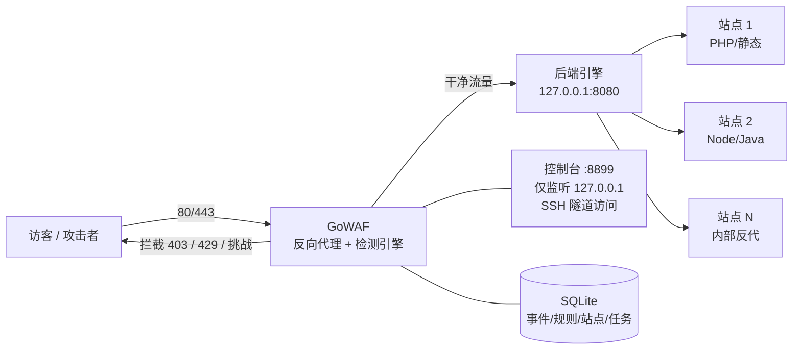
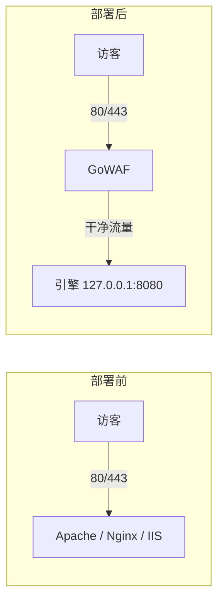

# GoWAF

**全平台、全环境兼容的单二进制反向代理 WAF。**

GoWAF 不是 Web 服务器的模块，而是站在它们**前面**的一层反向代理：
安装脚本自动探测面板与引擎，把 80/443 交给 GoWAF，后端退到 `127.0.0.1:8080`。
所有公网流量先过检测，干净请求原样转发给上游，恶意请求在到达业务代码之前就被拦截。

**Windows 不只是 IIS。** 小皮 Windows、宝塔 Windows、原生 Apache / Nginx 与 IIS 走同一套 `install.ps1`。

| 面板 / 环境 | Linux Apache | Linux Nginx / OpenResty | Windows Apache | Windows Nginx | IIS |
|---|:---:|:---:|:---:|:---:|:---:|
| **宝塔** | ✓ | ✓ | ✓ | ✓ | — |
| **1Panel** | — | ✓（OpenResty 容器） | — | — | — |
| **小皮** | ✓ | ✓ | ✓ | ✓ | — |
| **原生**（无面板） | ✓ | ✓ | ✓ | ✓ | — |
| **IIS** | — | — | — | — | ✓ |

- **单二进制部署**：控制台前端与 IP 归属地库通过 `go:embed` 打进二进制；Linux 一个 `install.sh`，Windows 一个 `install.ps1`
- **双引擎检测**：181 条自研规则（快、可解释）+ 内嵌 OWASP CRS v4（广覆盖、随上游更新），分数合并后统一判定
- **默认观察模式**：首次安装只记录不拦截，观察 3~7 天确认无误杀再切实时拦截
- **威胁情报 + 邮件告警**：订阅公共情报源，命中即封并自动并入封禁管理；封禁事件按窗口聚合发邮件
- **随时全身而退**：`rollback` / `uninstall` 自动还原引擎配置并重新接管流量

> 数据面本身引擎无关：对后端是 Apache、Nginx、OpenResty 还是 IIS 完全无感。
> 面板与引擎的差异全部收敛在部署脚本里，安装时自动探测，同机双引擎用 `--engine` 显式指定。

---

## Demo 示意图： https://github.com/xuey490/GoWaf/tree/main/demo

## 目录

- [工作原理](#工作原理)
- [支持的面板与引擎](#支持的面板与引擎)
- [功能一览](#功能一览)
- [界面预览](#界面预览)
- [技术栈](#技术栈)
- [快速开始](#快速开始)
- [打包与部署](#打包与部署)
- [安装场景指南](#安装场景指南)
- [反复安装 / 回滚 / 彻底卸载](#反复安装--回滚--彻底卸载)
- [控制台临时对外开放](#控制台临时对外开放)
- [命令速查](#命令速查)
- [本地开发与调试](#本地开发与调试)
- [项目结构](#项目结构)
- [关键技术细节](#关键技术细节)
- [已知降级](#已知降级)
- [尚未适配、建议后续加](#尚未适配建议后续加)
- [更新日志](CHANGELOG.md)

---

## 工作原理

### 整体架构



后端引擎可以是 **Apache、Nginx、OpenResty（1Panel 容器）或 IIS**（Linux / Windows 均可）。WAF 只负责检测与转发，站点内部的 `ProxyPass` / `proxy_pass` / 应用绑定原样保留。

### 流量接管方式（部署前后对比）



---

## 支持的面板与引擎

部署脚本是「**面板探测 × 引擎适配器**」两层结构：面板只决定配置路径、证书目录和重载方式，引擎适配器决定改什么语法。`install.sh doctor` / `install.ps1 doctor` 会打印当前探测结果，安装前建议先跑一遍。

### Linux（`deploy/install.sh`）

| 环境 | 接管方式 | 说明 |
|---|---|---|
| **宝塔 + Apache** | vhost 端口改写 + `mod_remoteip` | 原 Apache 链路；面板「保存站点」会把端口写回 80，`resync` 定时器每 60 秒纠正 |
| **宝塔 + Nginx** | `listen` 改写 + `realip` | 自动处理 `default_server` 冲突、强制 HTTPS 301 死循环 |
| **1Panel + OpenResty** | 按容器网络模式分流 | **bridge**：compose 端口重映射 `80:80 → 8080:80`，容器内配置零侵入；**host**：改写宿主挂载的 listen（含默认站点） |
| **小皮 Linux + Apache / Nginx** | 官方路径 + 宝塔同构兜底 | 官方 xp.cn：`/usr/local/phpstudy/soft/{nginx,apache}/<ver>` 与 `vhost/`；魔改版仍走 `/www/server/panel/vhost/{apache,nginx}`。残留 apt nginx/apache2 不算引擎 |
| **原生 systemd Apache / Nginx** | 常规接管 | Debian `sites-enabled`（含无后缀 `default` 与符号链接）/ `ports.conf` / `conf.d`；证书目录 `/etc/gowaf/certs` |

```bash
bash install.sh install                       # 自动探测面板与引擎
bash install.sh install --engine nginx        # 同机双引擎时显式指定
bash install.sh doctor                        # 只读体检：面板/引擎/站点/证书/端口
```

### Windows（`deploy/install.ps1`，管理员 PowerShell）

Windows 与 Linux 一样按「面板 × 引擎」探测，**不是只有 IIS**。七种已接组合：

| 环境 | 接管方式 | 说明 |
|---|---|---|
| **小皮 Windows + Apache** | vhost + `Listen` 改写 | `phpstudy_pro\Extensions\Apache*\conf\vhosts` |
| **小皮 Windows + Nginx** | `listen` 改写 | `phpstudy_pro\Extensions\Nginx*\conf\vhosts` |
| **宝塔 Windows + Apache** | vhost + `Listen` 改写 | `C:\BtSoft\apache\conf\vhost` 与 `httpd.conf` |
| **宝塔 Windows + Nginx** | `listen` 改写 | `C:\BtSoft\nginx\conf\vhost` |
| **原生 Apache** | vhost + `Listen` 改写 | `Apache24\conf\extra\httpd-vhosts.conf`（兼认 xampp / wamp） |
| **原生 Nginx** | `listen` 改写 | `C:\nginx\conf` 与 `conf.d`（兼认 `nginx-*` 解压目录） |
| **IIS** | `appcmd` 改绑定 | https 绑定转 http，TLS 由 WAF 终止 |

```powershell
.\install.ps1 doctor                     # 探测面板/引擎/站点/端口
.\install.ps1 install                    # 备份 → 引擎让出 80/443 → gowaf svc 开机自启 → 防火墙
.\install.ps1 install -Engine nginx      # 同机双引擎时显式指定（iis|apache|nginx）
.\install.ps1 install -Panel bt          # 同机多面板时显式指定（phpstudy|bt|system）
.\install.ps1 install -SearchRoot D:\apps
.\install.ps1 install -Engine nginx -VhostDir D:\stack\nginx\conf\vhost
.\install.ps1 rollback
```

默认会扫**所有盘符**根目录以及下一级子目录里的 `phpstudy_pro` / `BtSoft` / `Apache24` / `nginx`，并沿正在运行的 `httpd.exe` / `nginx.exe` 往上找配置。装在更深层自定义目录（例如 `D:\company\prod\stack\nginx`）时，自动探测会失败，这时用 `-SearchRoot` 指向父目录，或直接 `-Engine` + `-VhostDir`（可选 `-ConfFile`）。

Windows 服务模式用 `gowaf svc install|start|stop|uninstall` 实现（单二进制，无 NSSM 依赖）。

---

## 功能一览

| 模块 | 能力 |
|---|---|
| **反向代理** | Host 透传、多站点按域名/SNI 分流、WebSocket 原生升级、流式响应（FlushInterval）、内部反代站点透明兼容 |
| **TLS 终止** | 443 在 WAF 终止，SNI 多证书 + 通配符匹配，自动读取面板证书目录，`default_cert` 智能兜底；`--http-only` 可只接管 80 |
| **规则检测（双引擎）** | ① 181 条自研 YAML 规则：SQLi / XSS / 路径穿越 / RCE / 扫描器 / 敏感文件 / 文件上传 / 协议异常，AC 预筛 + RE2 精匹配，评分制，高危规则可设 `ban`（命中即封）；② 内嵌 OWASP CRS v4（Coraza v3），只加载请求阶段规则，偏执等级 1–4，两个引擎分数相加后统一判定 |
| **误报治理** | 例外规则按「站点 / 规则号 / 分类 / 路径前缀 / 参数名」组合放过（已填的维度必须全部命中），同时作用于自研引擎与 CRS；规则运营支持分组统计、命中样例、批量启停、导入导出 |
| **威胁情报** | 订阅公共/自建 IP 清单（10 个预设源一键添加），支持自定义 Header/Token 与 JSON 列表（AbuseIPDB、CrowdSec CTI）；命中的 IP 直接拦截并自动写入封禁管理，可在封禁列表统一释放 |
| **限流与封禁** | 单 IP RPS / 突发 / 每分钟阈值；**每站点独立限流实例**（互不占用全局指标）；自动封禁带连击机制（反复触发 → 加倍 → 永久封禁）；IP 白名单；名单与封禁均支持全局 / 站点作用域 |
| **告警通知** | 封禁事件按时间窗合并成一封摘要邮件（同 IP 冷却去重），SMTP 支持 ssl / starttls / none；通道预留飞书 / 短信 / 微信，当前版本只实现邮件 |
| **IP 归属地** | 内置离线库（ip2region 派生，21.6 万 IPv4 区间，1.3MB 嵌入二进制），攻击事件列表、详情与告警邮件直接显示国家/省市，零出网、零限速 |
| **站点级防护配置** | 全局配置 + 各站点覆盖：站点开启后以站点为准，限流计数按「站点 + IP」隔离 |
| **Cloudflare 适配** | 回源网段写入 trusted_proxies，按真实访客 IP 限流/封禁/记录（`cloudflare on` 一键开启，支持联网刷新官方网段）；CDN 标记支持全局或按站点 |
| **计划任务中心** | 定期清理攻击事件（按保留天数）、定期备份规则快照到 `data/backups/`，支持手动触发 |
| **控制台** | Vue 3 单页管理端 12 个模块：仪表盘 / 攻击事件 / 检测规则 / 例外规则 / 威胁情报 / 黑白名单 / 封禁管理 / 防护站点 / 告警通知 / 防护配置 / 计划任务 / 审计日志；JWT + CSRF + 登录锁定 + 按权限位校验写操作 |
| **自愈与运维** | 端口漂移自愈（面板改回端口每 60 秒自动纠正）、`doctor` 只读体检（部署形态 / 证书对照表 / 站点清单 / 端口占用）、日志 logrotate |
| **安全防线** | 无限代理自环防护（上游指向自身 80/443/8899 拒绝加载）、控制台默认仅回环、配置校验失败拒绝启动、情报匹配跳过回环/私网网段防自锁 |

---

## 界面预览

**安全总览** —— 请求/拦截趋势、攻击类型分布、攻击源 IP 与受攻击路径一目了然：


**攻击事件** —— 每条请求的风险分、命中规则、攻击类型、来源属地与响应码，支持导出 CSV 与实时订阅：


<details>
<summary><strong>更多控制台截图（点击展开）</strong></summary>

**检测规则** —— 181 条内置规则在线启停/调分/编辑，带规则调试器与命中样例：


**黑白名单** —— IP / CIDR 白名单与黑名单，支持批量导入与站点作用域：


**封禁管理** —— 自动封禁、规则直封与情报命中统一管理，一键全量解封：


**防护站点** —— 站点清单、上游地址、CDN 形态与站点级防护配置：


**防护配置** —— 全局阈值 / 限流 / 自动封禁 / CRS 引擎参数，改动即生效并留配置版本可回滚：


**计划任务** —— 定期备份检测规则、定期清理攻击事件，可手动立即执行：


</details>

> 上图为 v1.0 界面。v1.1 新增的「例外规则」「威胁情报」「告警通知」「审计日志」四个模块见控制台左侧菜单。

---

## 技术栈

**后端（Go 1.27）**

| 组件 | 选型 | 说明 |
|---|---|---|
| HTTP 服务 | `net/http` + `httputil.ReverseProxy` | 数据面，Rewrite 保留 RawPath，Host 透传，WebSocket 原生升级 |
| 管理面 | Gin v1.12 + GORM v1.31 | `/api` 路由、CSRF/权限/审计中间件 |
| 存储 | SQLite（glebarez 纯 Go 驱动，CGO_ENABLED=0，WAL） | 零依赖，静态编译，可交叉编译 |
| 自研检测 | AC 自动机（自实现）+ RE2 正则 | 181 条 YAML 规则，关键词预筛 → 正则精匹配，正则 50ms 超时熔断 |
| CRS 检测 | Coraza v3.8 + coraza-coreruleset（OWASP CRS v4） | 内嵌第二个引擎，`SecRuleEngine On` / `DetectionOnly`，偏执等级 1–4；协议合规类规则（920000–922000）单条降权 15、整段封顶 29，避免正常登录被累计到拦截线 |
| 威胁情报 | 自研区间集合（uint32 闭区间 + IPv6 前缀，二分查找） | 多源合并去重，单源失败保留上次快照；解析支持纯文本与 JSON 列表 |
| IP 归属地 | ip2region 派生离线库（`internal/geo`） | 21.6 万 IPv4 区间 / 640 个地区，gzip 后 1.3MB 嵌入二进制 |
| 告警通知 | `net/smtp` + `mime` | 时间窗聚合、同 IP 冷却、RFC 2047 中文主题、HTML 摘要模板 |
| 认证授权 | golang-jwt v5 + CSRF + 登录限速 | 写操作按权限位（`ip:ban` / `rule:write` / `site:write` …）校验 |
| 热更新 | `atomic.Pointer[快照]` / `atomic.Int64` | 规则集、例外集、CRS 引擎、IP 名单、封禁均为不可变快照整体替换，读路径无锁 |
| 可观测 | Prometheus `client_golang` + SSE | `/metrics` 暴露指标，`/api/stream/events` 实时推送攻击事件 |
| 迁移 | 顺序 SQL migrations（`internal/store/migrations`，`schema_meta` 记版本） | 升级自动补表/补列，当前 v6 |
| 嵌入 | `go:embed` | 前端产物 + 归属地库打进二进制，交付一个文件 |
| Windows 服务 | `golang.org/x/sys/windows/svc` | `gowaf svc` 真 SCM 服务，无第三方守护 |

**前端（控制台）**

Vue 3.5 + TypeScript 6 + Vite 8 + Naive UI 2.45 + Pinia 4 + Vue Router 5 + vue-i18n 11（中英双语）+ ECharts 6 + Tailwind CSS 4；
构建要求 Node ≥ 22.12、pnpm ≥ 8.8（仅改控制台时才需要前端源码）。

---

## 快速开始

前提：`go 1.27.3+` 即可（前端构建产物已直接提交在 `internal/web/dist`，不需要 node/pnpm）。
依赖只有 Gin、GORM、SQLite 纯 Go 驱动、Coraza + OWASP CRS、JWT、Prometheus 客户端，
全部静态编译，`CGO_ENABLED=0` 可交叉编译 linux/amd64、linux/arm64、windows/amd64。

```bash
# 构建 Linux / Windows 二进制（前端产物 go:embed 进二进制）
make build-all        # 产出 bin/gowaf-linux-amd64 / arm64 / windows-amd64.exe

# 也可以只构建本机平台
make build

# 交叉编译打包成可直接上传的 tar.gz（Linux 侧，含 install.sh + builtin.yaml）
bash deploy/package.sh amd64
```

> 只有要修改控制台界面时才需要前端源码 `Frontend/`（独立维护，不在本仓库内）。
> 改完执行 `make web` 同步回 `internal/web/dist` 再提交。

### Linux 服务器

宝塔、1Panel、小皮 Linux、原生 Apache / Nginx **命令相同**：解包后 `doctor` → `install`，脚本自动探测面板与引擎。只有同机同时跑了 Apache 和 Nginx 时才需要 `--engine`。

```bash
tar xzf gowaf-deploy-*.tar.gz && cd gowaf-deploy-*
./install.sh doctor             # 建议先体检：面板、引擎、站点、证书、端口
./install.sh install            # 一键部署，默认 observe 观察模式
ssh -L 8899:127.0.0.1:8899 root@<服务器IP>   # 隧道访问控制台
# 浏览器打开 http://127.0.0.1:8899 ，账号 admin（初始密码见 /www/server/gowaf/data/initial-password.txt）

# 观察 3~7 天确认无误杀后，切实时拦截：
./install.sh protect
```

**安装过程做了什么（任一步失败都会自动回滚引擎配置，站点不会长时间中断）：**

1. 备份引擎主配置与全部站点文件到 `/www/server/gowaf/backup/<时间戳>/`（保留最近 10 份；1Panel 还会备份 `docker-compose.yml`）
2. 让后端退出 80/443，改为监听 `127.0.0.1:8080`（Apache 改 VirtualHost；Nginx 改 listen；1Panel bridge 改 compose 端口映射）
3. 注入真实 IP 透传（Apache `mod_remoteip` / Nginx `realip`），并修复强制 HTTPS 301 死循环
4. 生成配置（从 vhost 提取站点清单 + 自动挑选覆盖域名最多的 TLS 默认证书）
5. 安装 `gowaf.service`（`ExecStartPre` 先校验配置）+ 端口漂移自愈定时器 + logrotate
6. 启动 gowaf 绑定 80/443，做 HTTP/HTTPS 连通性自检

### Windows 服务器

小皮、宝塔 Windows、原生 Apache / Nginx、IIS **命令相同**：解包后 `doctor` → `install`。同机双引擎加 `-Engine`，多面板加 `-Panel`。

```powershell
Expand-Archive gowaf-deploy-*-windows-amd64.zip
cd gowaf-deploy-*
.\install.ps1 doctor
.\install.ps1 install            # 默认观察模式；数据目录 C:\ProgramData\gowaf
# 控制台：ssh -L 8899:127.0.0.1:8899 administrator@<服务器IP>
# 浏览器打开 http://127.0.0.1:8899
```

---

## 打包与部署

### 方式一：PowerShell 一键打包（Windows 开发机）

```powershell
.\deploy\package.ps1                          # linux/amd64 tar.gz（用仓库自带前端产物）
.\deploy\package.ps1 -Arch arm64              # 交叉编译 arm64
.\deploy\package.ps1 -Platform windows        # windows/amd64 zip（小皮/宝塔/原生 Apache·Nginx / IIS）
.\deploy\package.ps1 -WithWebBuild            # 本机有 Frontend 源码时：先 pnpm build 再打包
```

产出（位于 `dist/`）：

```
gowaf-deploy-<版本>-linux-amd64.tar.gz / .sha256
gowaf-deploy-<版本>-windows-amd64.zip / .zip.sha256
```

包内容：二进制 + 部署脚本 + `rules/builtin.yaml`。

### 方式二：Linux 一键打包（Makefile / package.sh）

```bash
make package                 # linux/amd64 tar.gz + sha256，产出在 dist/
bash deploy/package.sh arm64 # 交叉编译 arm64
```

### 方式三：Makefile 手动打包

```bash
make build-all
mkdir gowaf-deploy && cp bin/gowaf-linux-amd64 deploy/install.sh rules/builtin.yaml gowaf-deploy/
tar czf gowaf-deploy.tar.gz gowaf-deploy/
sha256sum gowaf-deploy.tar.gz > gowaf-deploy.tar.gz.sha256
```

### 上传与安装

```bash
scp gowaf-deploy-*.tar.gz root@服务器IP:/tmp/
ssh root@服务器IP
cd /tmp && tar xzf gowaf-deploy-*.tar.gz && cd gowaf-deploy-*
sha256sum -c ../gowaf-deploy-*.tar.gz.sha256   # 可选：校验完整性（按实际文件名调整）
./install.sh install
```

> 注意：脚本**不接受**在服务器上 `go build`（生产环境缺 git/前端产物必然失败），
> 必须带上编译好的二进制，或用 `--binary /path/to/gowaf` 显式指定。
> 升级重装时**不会覆盖**服务器上已有的规则文件（你在生产上调优的规则比仓库新），要强制覆盖加 `--rules`。

---

## 安装场景指南

### 场景 A：普通 HTTP 站点（未上 CDN）

最简单的情况，直接装：

```bash
./install.sh install
```

- 脚本自动扫描站点配置生成清单，上游统一 `http://127.0.0.1:8080`
- 证书目录为空 → 只接管 80，443 原样留给后端引擎（HTTPS 流量不经过 WAF）
- 证书目录有证书（面板 SSL / 手工放置）→ 自动接管 80 + 443，TLS 由 WAF 终止
- 想强制最保守上线（即使有证书也不碰 443）：

```bash
./install.sh install --http-only
```

> WAF 页面里的「上游地址」统一填 `http://127.0.0.1:8080` 即可——这是安装时
> 引擎让出 80 后退守的内部端口。站点内部如果还有多条 `ProxyPass` / `proxy_pass`
> （前后端分离、多个后端端口），**不需要**在 WAF 里逐条配置：WAF 只管把域名流量
> 整包转给引擎，引擎内部的分发逻辑原样保留。

同机同时跑了 Apache 和 Nginx 时，脚本会拒绝猜测，必须显式指定：

```bash
./install.sh install --engine apache
./install.sh install --engine nginx
```

### 场景 B：Cloudflare 橙云站点（或混合部署）

橙云站点的回源 IP 是 Cloudflare 节点而非真实访客。不处理的话，限流/封禁会按
CF 节点 IP 计算——**一封一大片**。

**全部站点都在 CF 后面**（安装时直接声明）：

```bash
./install.sh install --cloudflare
```

**混合部署（一部分橙云 + 一部分直连）**，装完再按需开关：

```bash
./install.sh install
./install.sh cloudflare on       # 全局启用：CF 回源网段写入 trusted_proxies
./install.sh cloudflare status   # 查看当前状态与网段数
./install.sh cloudflare update   # 联网刷新 Cloudflare 官方最新网段
./install.sh cloudflare off      # 全部直连时关闭
```

更精细的控制：在控制台「站点管理」里对**单个站点**标记「Cloudflare 加速」，
只对该站点做真实 IP 还原，其他站点保持直连语义。混合场景下全局开关 + 站点级
标记可以自由组合。

**CF 站点还有两条配套要求：**

- Cloudflare SSL/TLS 模式必须是 **Full 或 Full (strict)**；Flexible 会导致 301 死循环
- 每个走 CF 的域名都要有证书覆盖（回源 SNI 对不上证书时 Full (strict) 会报 526）。
  装完跑一次 `./install.sh doctor`，它会输出「域名 → 证书目录」对照表并列出无证书覆盖的域名

### 场景 C：拿不准服务器现状？

先体检，不动任何东西：

```bash
./install.sh doctor          # Linux
.\install.ps1 doctor         # Windows
```

输出：当前面板与引擎、部署形态（是否已接管 443）、每张证书的 SAN 与覆盖的域名、
全部站点的 ServerName / server_name / IIS 绑定、站点 → 证书对照表、
80/443/8080/8899 端口占用者、引擎配置语法与连通性自检。

### 场景 D：各平台注意点

**宝塔 Linux（Apache / Nginx）**

- Apache 由 SysV 脚本托管（`systemctl` 常显示 `active (exited)`），脚本优先走 `/etc/init.d`
- 面板「保存站点」会按模板重写 vhost，把端口改回 80/443 —— `gowaf-resync.timer` 每 60 秒纠正
- 证书目录是站点名不是域名（甚至可能是 IP），脚本读每张证书真实 SAN 再匹配
- 面板自身端口（默认 8888）不动

**1Panel（OpenResty Docker）**

- **bridge 网络**：改宿主 compose 端口映射，容器内 nginx 配置一字不改，升级 OpenResty 不回退
- **host 网络**：容器直接绑宿主 80/443，无端口映射可改，改为改写宿主挂载的 listen（含默认站点）
- `realip` 信任段会带上 Docker 网桥网段（`172.16.0.0/12`、`10.0.0.0/8`），否则日志全是网关 IP
- 重载走 `docker exec <openresty> nginx -s reload`

**小皮 Linux**

- 官方 xp.cn：`/usr/local/phpstudy/soft/{nginx,apache}/<ver>`，站点 `vhost/{nginx,apache}`，证书 `vhost/cert/<域名>`
- 部分魔改版仍走 `/www/server/panel/vhost/{apache,nginx}`，脚本两种都认
- 探测时忽略残留 apt `/etc/nginx`、`/etc/apache2`，避免被误判成双引擎
- 面板「保存/重定向」同样会覆盖 vhost，依赖 resync 兜底

**原生 Nginx / Apache**

- 命令与面板环境相同，证书放 `/etc/gowaf/certs/<域名>/`；GoWAF 主目录仍是 `/www/server/gowaf`
- Nginx：Debian `sites-enabled`（含无后缀 `default`）或 `conf.d`；改写穿过符号链接写回 `sites-available`
- `listen 80` → `listen 127.0.0.1:8080`，IPv6 listen 注释掉
- 多个 `default_server` 改到 8080 后会冲突，脚本改写时去掉该标记（未知 Host 由 WAF 兜底站点接管）
- Apache：系统 `apache2` / `httpd`；Debian 全局 `Listen 80/443` 在 `ports.conf`（不只 `apache2.conf`），脚本会一并注释并纳入 backup / rollback

**小皮 / 宝塔 / 原生 Windows / IIS**

- **不是只有 IIS**：小皮 Apache·Nginx、宝塔 Apache·Nginx、原生 Apache·Nginx、IIS 都走 `install.ps1`
- 命令相同：`.\install.ps1 doctor` → `.\install.ps1 install`；同机双引擎加 `-Engine`，多面板加 `-Panel`，非默认安装路径加 `-SearchRoot` 或 `-VhostDir`
- 主目录 `C:\ProgramData\gowaf`（data / logs / configs）
- 防火墙走 `netsh advfirewall`
- 小皮：`phpstudy_pro\Extensions\{Apache,Nginx}*\conf\vhosts`
- 宝塔 Windows：`C:\BtSoft\{nginx,apache}\conf\vhost`，证书优先 `C:\BtSoft\panel\vhost\ssl`
- 原生 Apache：`Listen 80/443` 写在 `httpd.conf`，站点多在 `conf\extra\httpd-vhosts.conf`，脚本两处都改
- 原生 Nginx：主配置 + `conf.d`；`default_server` 改到 8080 后会摘掉以免冲突
- IIS：改绑定前备份 `applicationHost.config`；https 绑定转 http（TLS 已在 WAF 终止）
- 小皮/原生证书无统一目录时，可把证书放到 `C:\ProgramData\gowaf\data\certs` 或在控制台上传

---

## 反复安装 / 回滚 / 彻底卸载

### 可以反复 install 吗？

**可以，install 是幂等的，专门为重装/升级设计：**

- 检测到已安装 → 提示「重新生成配置并重启服务」，确认后继续（`--force` / `-Force` 跳过确认）
- 引擎已退守 8080 是「重装正常态」，不会被误判为端口冲突
- 配置文件一个字节没变时**跳过引擎重启，站点零中断**；只有真改了配置才走「停 → 等 80 真空 → 起」
- 二进制替换用「旧文件改名 + 新文件落位 + 最后一次性 restart」：老进程继续用旧 inode 服务 80，中断压缩到一次重启（1~3 秒）
- 重装**保留**：已有规则文件、已切过的 protect 模式、Cloudflare 标记（`.cloudflare` 标记文件）
- 中途任何一步失败（端口没让出、gowaf 起不来、配置校验失败）→ 自动还原引擎配置并给出诊断证据

### 出问题想立刻恢复？

```bash
./install.sh rollback          # Linux
.\install.ps1 rollback         # Windows
```

从 `backup/latest` 还原引擎主配置 + 全部站点文件（备份目录里的 `meta.env` / `meta.json`
记录了部署时的真实路径与服务名，即使环境后来变过也按原样还原），重载引擎——
**80/443 自动交还给原引擎，流量恢复直连**，站点回到部署前状态。
gowaf 服务与文件仍保留，只是停用。

### 彻底卸载会自动还原吗？

**会。** `uninstall` 第一步就是先执行完整的 `rollback`（还原引擎配置并重载，
引擎重新接管 80/443），然后再清理：

```bash
./install.sh uninstall
# Linux 将删除：gowaf.service、resync 定时器、logrotate、/www/server/gowaf（含数据库/日志/备份）、
#               /usr/local/bin/gowaf 管理命令 —— 有二次确认

.\install.ps1 uninstall
# Windows 将删除：gowaf Windows 服务、C:\ProgramData\gowaf —— 有二次确认
```

卸载完成后服务器回到 GoWAF 安装之前的样子，原引擎直接面对公网。

---

## 控制台临时对外开放

控制台默认只监听 `127.0.0.1:8899`，正规用法是 SSH 隧道。要在浏览器里直接连
（比如临时给同事看一眼），用内置的临时外放，**到点自动收回**：

```bash
./install.sh console open                      # 默认只放行你当前 SSH 来源 IP，2 小时后自动收回
./install.sh console open --ip 1.2.3.4 --hours 4
./install.sh console open --ip all             # 全网放行（不建议）
./install.sh console status                    # 查看当前状态与自动收回倒计时
./install.sh console close                     # 立刻收回
```

`console open` 一次性改好三样东西并互相校验：

1. `admin_listen` 改为 `0.0.0.0:8899`（并写入知情开关标记）
2. `allowed_ips` 收紧到指定来源（默认自动取当前 SSH 客户端 IP，不用手打）
3. 主机防火墙放行 8899（ufw / firewalld / iptables 自动识别）

到期由 systemd timer 自动执行 `console close`：撤防火墙规则、配置改回仅回环、
删知情开关。`close` 在 gowaf 未运行时**只改配置不强启服务**，避免崩溃循环。

> 云厂商安全组需要你自己在控制台放行 8899。长期访问请用 Cloudflare Tunnel 或
> SSH 隧道，不要长期开放。密码错误 5 次锁 15 分钟。

---

## 命令速查

### Linux（`install.sh`，安装后也可用短命令 `gowaf`）

| 命令 | 作用 |
|---|---|
| `install.sh install` | 一键部署（默认 observe，任一步失败自动回滚） |
| `install.sh install --http-only` | 只接管 80，443 完全不动 |
| `install.sh install --cloudflare` | 安装并启用 CF 回源识别 |
| `install.sh install --engine nginx` | 同机双引擎时指定接管 Nginx（或 `apache`） |
| `install.sh install --upstream-port 8090` | 自定义后端回退端口 |
| `install.sh start / stop / restart` | 服务控制（stop 后站点不可访问，需 rollback 恢复） |
| `install.sh status / logs` | 状态+端口+日志 / 实时日志 |
| `install.sh observe / protect` | 观察模式（不拦截）/ 实时拦截 |
| `install.sh cloudflare on/off/update/status` | Cloudflare 回源 IP 识别 |
| `install.sh console open/close/status` | 控制台临时外放 / 收回 / 状态 |
| `install.sh resync` | 手动纠正端口漂移（面板改回端口时；定时器每 60 秒自动跑） |
| `install.sh rollback` | 还原引擎并停用 gowaf（流量立即恢复直连） |
| `install.sh uninstall` | 先还原再彻底卸载（含数据，二次确认） |
| `install.sh doctor` | 只读体检，不改任何东西 |

安装后短命令软链到 `/usr/local/bin/gowaf`。

### Windows（`install.ps1` / `gowaf.exe svc`）

| 命令 | 作用 |
|---|---|
| `install.ps1 install` | 一键部署 |
| `install.ps1 install -Engine iis` | 显式指定 IIS（或 `apache` / `nginx`） |
| `install.ps1 install -Panel bt` | 同机多面板时指定宝塔（或 `phpstudy` / `system`） |
| `install.ps1 install -SearchRoot D:\apps` | 安装目录不在盘符根下时，把父目录加进搜索 |
| `install.ps1 install -Engine nginx -VhostDir D:\stack\nginx\conf` | 完全自定义路径，不依赖目录名 |
| `install.ps1 install -HttpOnly` | 只接管 80 |
| `install.ps1 doctor / status` | 只读体检 / 服务与端口 |
| `install.ps1 start / stop` | 服务控制 |
| `install.ps1 rollback` | 还原引擎配置，流量回到引擎直连 |
| `install.ps1 uninstall` | 先还原再删服务与数据目录 |
| `gowaf.exe svc install\|start\|stop\|uninstall` | Windows SCM 服务管理 |

---

## 本地开发与调试

### 启动

```bash
# 一键启动（读 configs/config.yaml，数据/控制台按 dev 配置监听回环）
make run
# 或者直接
go run ./cmd/gowaf -c configs/config.yaml

# 只校验配置，不启动（改完配置先验一把）
go run ./cmd/gowaf -c configs/config.yaml -t

# 打印版本
go run ./cmd/gowaf -v
```

本地默认监听（见 `configs/config.yaml`）：

| 地址 | 用途 |
|---|---|
| `http://127.0.0.1:8899` | 控制台（管理面） |
| `http://127.0.0.1:8089` | 数据面，**用 Host 头模拟不同站点**（dev 配置的站点是 `localhost` / `127.0.0.1` / `demo.local`） |

**首次启动**会自动创建管理员 `admin`，随机 16 位密码写入 `data/initial-password.txt`
（`data/` 不入库，删掉它重启即可重新生成）。

### 模拟流量验证 WAF

```bash
# 正常请求（engine.mode: protect 时干净流量应 200）
curl -s -o /dev/null -w "%{http_code}\n" -H "Host: demo.local" http://127.0.0.1:8089/

# SQL 注入 payload → 应返回 403，事件进控制台
curl -s -o /dev/null -w "%{http_code}\n" -H "Host: demo.local" "http://127.0.0.1:8089/?id=1+union+select+1,2,3"

# XSS payload
curl -s -o /dev/null -w "%{http_code}\n" -H "Host: demo.local" "http://127.0.0.1:8089/?q=%3Cscript%3Ealert(1)%3C/script%3E"

# 敏感文件探测
curl -s -o /dev/null -w "%{http_code}\n" -H "Host: demo.local" http://127.0.0.1:8089/.git/config
```

返回码含义：`200` 放行、`403` 拦截、`429` 限流。控制台「攻击事件」页可看
每条命中的规则、评分与来源；日志在 `logs/waf.log`。

> **用 curl 测试请带上浏览器 UA**：curl 默认 UA（`curl/8.x`）会命中内置的
> `scanner-ua` 规则，而这条规则是 `action: ban`（命中即封），本机测试很容易把
> `127.0.0.1` 封掉，之后所有请求都返回 `403 X-Waf-Reason: ip_banned`，看起来像
> 「配置没生效」。加 `-A "Mozilla/5.0 ..."` 即可；真被封了就在控制台「封禁管理」
> 释放，或 `sqlite3 data/waf.db "delete from bans where ip='127.0.0.1';"` 后重启。

> 注意两点：① 检测模式以**数据库/控制台**设置为准（配置文件里的 `engine.mode`
> 只在首次建库时生效），如果 payload 返回 200，先到控制台确认当前是不是
> observe 观察模式；② 启动报「端口被占用」说明 8089/8899 已被别的进程监听，
> `netstat -ano | findstr 8089` 找到 PID 换端口即可。

### 测试与代码检查

```bash
make test          # go test ./...
make test-adapter  # Linux 适配器单测 + Windows 六种环境适配器单测（有 pwsh 时）
make vet           # go vet ./...
make fmt           # gofmt
```

本机没有完整面板时，可用实验室脚本按对应目录与配置模板搭一套可被 `install.sh` 识别的环境：

```bash
sudo bash deploy/lab-bt-nginx.sh          # 宝塔 Nginx：/www/server/{panel,nginx}
sudo bash deploy/lab-phpstudy.sh apache  # 小皮 Linux Apache：/usr/local/phpstudy/soft/apache/<ver>
sudo bash deploy/lab-phpstudy.sh nginx   # 小皮 Linux Nginx：/usr/local/phpstudy/soft/nginx/<ver>
sudo bash deploy/lab-system.sh apache    # 原生 Debian Apache：/etc/apache2/sites-enabled
sudo bash deploy/lab-system.sh nginx     # 原生 Debian Nginx：/etc/nginx/sites-enabled（含无后缀 default）
sudo bash deploy/install.sh doctor
sudo bash deploy/install.sh install --force --binary bin/gowaf-linux-amd64
pwsh -File deploy/test-windows-adapter.ps1   # 小皮/宝塔/原生 Apache·Nginx 六种 Windows 布局（不需要 Windows 主机）
```

小皮 Linux 官方安装包（xp.cn）解压到 `/usr/local/phpstudy`，站点在 `vhost/{nginx,apache}`，证书在 `vhost/cert/<域名>`。部分魔改版仍走宝塔同构路径 `/www/server/panel/vhost/{nginx,apache}`，脚本两种都认。探测时忽略机器上残留的 apt `/etc/nginx`、`/etc/apache2`，避免宝塔/小皮被误判成双引擎。

### 断点调试（Delve）

```bash
dlv debug ./cmd/gowaf -- -c configs/config.yaml
# 常用断点位置：
#   internal/edge/edge.go        请求处理流水线（检测/限流决策）
#   internal/detect/rules.go     规则匹配与评分
#   internal/proxy/router.go     站点路由匹配
```

### 前端联调（需 Frontend 源码，不在本仓库）

```bash
cd Frontend && pnpm dev     # Vite dev server，默认 http://127.0.0.1:3006
# configs/config.yaml 的 admin.cors.allow_origins 已放行 3006，
# 前端把 API 代理到 127.0.0.1:8899 即可热更新调试；改完 pnpm build
# 并执行 make sync-web 把产物同步回 internal/web/dist 再提交
```

---

## 项目结构

```
gowaf/
├── cmd/
│   ├── gowaf/              # 入口：参数解析、配置加载、启动；Windows 另有 svc 子命令
│   └── geo-gen/            # 归属地库生成工具：ip2region 源数据 → internal/geo/data/geo.bin.gz
├── internal/
│   ├── app/                # 应用装配（各模块依赖注入、生命周期）
│   ├── config/             # 配置解析与校验
│   ├── edge/               # 请求处理流水线：黑名单 → 封禁 → 白名单 → 情报 → 静态跳过 → 限流 → 读体 → 检测 → 转发
│   ├── detect/             # 检测：AC 自动机 + 归一化 + 自研规则评分（rules.go）、OWASP CRS 引擎（crs.go）、例外（exceptions.go）
│   ├── intel/              # 威胁情报：多源同步、区间集合二分查找、Header/JSON 清单解析
│   ├── guard/              # 限流器（每站点独立）、IP 名单、自动封禁策略、CF 真实 IP
│   ├── notify/             # 告警通知：聚合队列、SMTP 发送、邮件模板
│   ├── geo/                # 离线 IP 归属地（嵌入 geo.bin.gz，21.6 万区间）
│   ├── proxy/              # 反向代理、多站点路由、TLS/SNI 多证书
│   ├── runtime/            # 运行时状态：站点+限流器热加载、CDN 标记、自环防护、快照热更新
│   ├── admin/              # 管理面：auth / handler / middleware / response
│   ├── store/              # GORM + SQLite、migrations、事件与站点模型、种子数据
│   ├── tasks/              # 计划任务中心（清理事件、备份规则）
│   ├── metrics/            # 指标统计
│   └── web/                # go:embed 前端构建产物（仓库直接自带，clone 后即可编译）
├── rules/builtin.yaml      # 181 条内置检测规则（YAML，可在线增删改）
├── deploy/
│   ├── install.sh          # Linux 一键部署：宝塔 / 1Panel / 小皮 / 原生 Apache·Nginx
│   ├── install.ps1         # Windows 一键部署：小皮 / 宝塔 / 原生 Apache·Nginx / IIS
│   ├── package.sh          # Linux 侧交叉编译打包（tar.gz）
│   ├── package.ps1         # Windows 侧交叉编译打包
│   └── lab-*.sh            # 无面板环境用的实验室脚本（宝塔 / 小皮 / 原生目录模拟）
├── configs/config.yaml     # 本地开发配置样例
├── docs/                   # 适配评估、开发方案等补充文档
└── Makefile                # build / build-all / test / vet / fmt / web / sync-web
```

> 控制台前端源码（Vue 3 + Naive UI）独立维护，不在本仓库内；
> 仓库自带其构建产物 `internal/web/dist`，`go build` 即可得到完整功能。

**规则文件格式**（`rules/builtin.yaml`，控制台可在线管理）：

```yaml
- id: sqli-union
  name: SQL 注入 - UNION 查询
  category: sqli            # sqli/xss/traversal/rce/scanner/sensitive_file/upload/protocol
  score: 60                 # 命中加分，累计 >= block_score 拦截、>= challenge_score 挑战
  targets: [query, body, path]   # 检测目标：path/query/body/header/cookie/ua
  keywords: ["union"]       # AC 预筛关键词（性能闸门，须取最短特征词）
  pattern: '\bunion\b[\s\S]{0,25}\bselect\b'   # RE2 正则，自动加 (?i)
  action: block             # pass / log / challenge / block / ban（ban = 命中即封 IP）
  priority: 100
```

---

## 关键技术细节

- **评分制检测**：每条规则命中加分，累计分决定动作（拦截 / 挑战 / 记录）。
  `block_score`、`challenge_score` 用原子变量存储，控制台改阈值即时生效，不重启。
  高危规则可设 `action: ban`，命中一次立即封禁来源 IP，不走评分累计。
- **性能闸门**：归一化文本先进 AC 自动机做关键词预筛，关键词不出现则正则根本不跑；
  正则匹配整体 50ms 超时熔断（RE2 + deadline），防止恶意 payload 打爆 CPU。
- **双引擎协同**：自研规则负责「快、准、可解释」的业务规则，CRS 负责广覆盖的通用特征、
  随上游更新，两者并行跑、分数相加后由同一个 `decide()` 判动作。没有把 SecRule 翻译成
  YAML —— CRS 依赖变换链（`t:urlDecodeUni`）、`ARGS_NAMES`、`chain` 与 `TX` 变量，
  翻译只能覆盖三成规则，丢了变换链等于筛子，所以直接嵌 Coraza 引擎。
- **CRS 误报控制**：`920000–922000` 这段协议合规类规则（`920620` 等）在完全正常的
  登录 POST 上也能累计到大几十分，足以顶到 `block_score`（默认 60）触发自动封禁。
  已对其单列降权：单条权重封顶 15、整段总分封顶 29（永远够不到 `challenge_score` 30）。
  遇到「正常请求被拦」，先看事件里的 `ruleIds` 是否 920/921 开头。
- **威胁情报**：清单在内存里压成「排序的 uint32 闭区间 + IPv6 前缀表」，命中走二分查找，
  几万条区间也不影响转发延迟；每源一个快照，单源拉取失败保留上次数据，不会因为网络抖动
  把防护清零。匹配前先跳过回环/私网/CGNAT 等特殊用途地址——公共清单常混入
  `127.0.0.0/8` 这类 bogon，反代场景下上游漏传 `X-Forwarded-For` 会让 clientIP 退化成
  `127.0.0.1`，不挡住就是整站 403。
- **归属地零依赖**：`geo.bin.gz` 在构建期由 `cmd/geo-gen` 从 ip2region 源数据生成
  （只保留国家/省/市，丢掉 ISP 与经纬度，压到 1.3MB），运行时一次二分查找；
  回环 → `本机`，私网 → `内网`，IPv6 → `IPv6`。
- **告警聚合**：封禁事件先进内存队列，按 `notify.window`（默认 60 秒）合并成一封摘要邮件，
  同一 IP 在 `notify.cooldown`（默认 3600 秒）内只报一次，避免被扫描器刷成邮件轰炸。
  评分阈值只过滤「有评分」的事件，情报封禁这类 score=0 的不会被吞掉。
- **配置优先级（容易踩）**：`config.yaml` 里的 `engine.*`、`guard.*`、`storage.*` 只是
  **初始值**——某个键在 `settings` 表里还不存在时才从配置文件灌进去，之后一律以表为准
  （控制台改的也是表）。所以改 `config.yaml` 的 `engine.mode` 对已部署实例不生效，
  切模式请用 `gowaf observe|protect` 或控制台，两边会同步写文件与表。

- **观察模式语义**：`observe` 不只是「不新封」，而是让黑名单 → 封禁 → 情报整条拦截链路
  退化为只看不拦，已存在的封禁也不再拦人；限流不受 observe 约束（限流是真 429），
  所以安装脚本在 observe 下会把限流阈值放到极宽。
- **请求体检测三态**：`Content-Length` 超过 `max_body_inspect`（默认 256KB）→ 不读直接透传；
  chunked → 透传；**谎报长度**（实际超限）→ 413。大文件上传（视频/附件）不受影响。
- **每站点限流隔离**：运行时为每个站点构建独立 `Limiter`，计数按「站点 + IP」隔离；
  站点开启自己的防护配置后以站点阈值为准，不占用全局指标。实测：站点限 2 req/s
  第 3 请求 429，全局阈值站点不受影响。
- **无限自环防护**：站点上游端口命中 WAF 自身监听端口（80/443/8899）时拒绝加载该站点，
  防止「控制台兜底站点上游填 127.0.0.1:80」这类配置引发请求风暴打爆内存。
- **真实 IP 还原**：WAF 同机后端只信任 `127.0.0.1` 的 X-Forwarded-For（1Panel 额外信任 Docker 网段）；
  CF 场景把官方回源网段写入 trusted_proxies，按最近一跳的可信代理逐段还原。
- **TLS 与 301 死循环**：TLS 在 WAF 终止后，Apache 注入 `SetEnvIf X-Forwarded-Proto "^https$" HTTPS=on`，
  Nginx 把 `$server_port !~ ^443` / `$scheme = http` 改成看 `X-Forwarded-Proto`，
  否则站点里的强制跳转规则会对 HTTPS 访客无限 301。
- **Nginx default_server**：多个 server 块都带 `default_server` 时全部改到 8080 会直接拒启。
  改写时去掉该标记，未知 Host 由 WAF 兜底站点接管。
- **1Panel 双拓扑**：bridge 走 compose 端口重映射（容器内零侵入）；host 网络无映射可改，
  改为改写宿主挂载的 listen，升级 OpenResty 不回退。
- **面板兼容**：宝塔/小皮「保存站点」会把 vhost 端口写回 80，自愈定时器每 60 秒检测并纠正，
  纠正前自动备份。宝塔上的 Apache 由 SysV 脚本托管，脚本优先走 `/etc/init.d`。
- **default_cert 智能选择**：面板证书目录名经常是「站点名」不是域名（甚至可能是 IP），
  脚本读每张证书的真实 SAN，选「覆盖 vhost 域名最多」的一张做 SNI 兜底，
  并给出「无证书覆盖域名」清单（CF 回源会 526 的隐患）。
- **Windows**：`gowaf svc` 走真 SCM；自动探测小皮 / 宝塔 `C:\BtSoft` / 原生 Apache24·nginx / IIS。IIS 用 appcmd 改绑定（https→http），后端真实 IP 降级为 127.0.0.1。
- **部署安全网**：`ExecStartPre` 配置校验失败宁可不启动；指纹比对决定是否真的重启
  引擎；`set -Eeuo pipefail` + 禁止空变量 cp + 精确端口匹配（`:80` 不误伤 `:8080`）。

---

## 已知降级

- **IIS 真实 IP**：IIS 无 `mod_remoteip` 等价物，后端应用看到的客户端 IP 是 `127.0.0.1`。WAF 在边缘看到真实 IP，限流/封禁不受影响。
- **QUIC / HTTP3**：WAF 不接 UDP 443；doctor 会提示，不做自动改写。
- **IPv6**：暂不接管 IPv6 listen（会注释以免与 WAF 抢端口），IPv6 流量仍直连源站。
- **威胁情报依赖出网与 DNS**：同步时要能访问清单 URL；DNS 或出网故障时同步失败，会保留上一次快照（不会把防护清零），失败原因写在情报源列表的「上次错误」里。
- **CRS 有额外 CPU 开销**：内嵌 CRS 默认开启（`engine.crs.enabled=true`，block/PL1），比纯自研规则多一轮全量匹配；低配机器可切 `engine.crs.mode=log` 只记录，或直接关掉。
- **告警通道只有邮件**：飞书 / 短信 / 微信只在通道列表里占位，尚未实现。
- **Windows 无 resync 定时器**：Linux 宝塔/小皮「保存站点」会把端口写回 80，`gowaf-resync.timer` 每 60 秒纠正；Windows 版目前只能再跑一次 `install.ps1 install` 或手工改回。

---

## 尚未适配、建议后续加

数据面本身仍引擎无关，缺的是**部署脚本里的路径探测 + 改写 + 重载**。按国内常见程度排序：

| 优先级 | 环境 | 为什么还没接 | 工作量大致形态 |
|---|---|---|---|
| **高** | **LNMP 一键包**（licess `/usr/local/nginx`） | 国内无面板 VPS 很常见；现在只认 Debian `/etc/nginx` 和宝塔 `/www/server/nginx`，这套路径探测不到 | 复用 Nginx 适配器，加一组路径 |
| **高** | **原生 OpenResty**（`/usr/local/openresty`，非 1Panel 容器） | 1Panel 已接的是 Docker；裸装 OpenResty 不会被当成引擎 | 近似原生 Nginx，路径和 `nginx -s reload` 不同 |
| **高** | **宝塔 OpenLiteSpeed / OLS** | 宝塔可把网站引擎切到 OLS；配置是 `httpd_config.conf`，不是 Apache/Nginx | 新适配器 |
| **中** | **Windows 端口漂移自愈** | 宝塔/小皮 Windows 保存站点同样会覆盖 vhost，现在没有 Linux 那套 60 秒 resync | `install.ps1` 加计划任务 |
| **中** | **Tengine** | Nginx 分支，二进制名和默认前缀不同 | 基本可复用 Nginx 适配器 |
| **中** | **独立 Docker Nginx**（非 1Panel） | 只适配了 1Panel 的 OpenResty 网站引擎；自己 `docker run nginx` 不会改端口映射 | 接近 1Panel bridge 路线 |
| **低** | **Caddy** | `Caddyfile` 语法完全不同 | 新适配器 |
| **低** | **cPanel / Plesk / DirectAdmin / CyberPanel** | 海外面板，国内占比低 | 适配器接口已留 |
| **低** | **WDCP / AMH / 彩虹等小众国内面板** | 路径各异、用户少 | 需求出现再接 |
| **不做** | macOS、K8s Ingress、商业 LiteSpeed | 超出当前「单机反向代理接管 80/443」形态 | — |

已经能当「原生 Apache」扫到、但不是一等公民的：**XAMPP / WAMP**（Windows）。aaPanel 国际版目录与宝塔 Linux 同构，现有 `PANEL=bt` 探测大概率能用，但没有单独实验室。

更细的适配评估见 [docs/panel-adaptation-assessment.md](docs/panel-adaptation-assessment.md)。

---

## License

[AGPL-3.0](./LICENSE)
